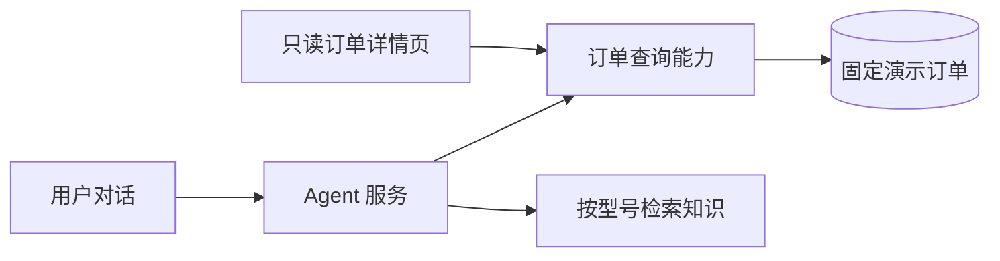

# 订单系统 MVP 产品方案

日期：2026 年 9 月 25 日

状态：待用户审阅；技术实现待 Technical Builder 接手审计
关联场景：[初赛产品方案「案例一：订单查询与知识分域」](初赛提交方案/Anker智能客服产品方案.md)

## 1. 要交付的结果

用户在客服对话中提供演示订单号后，能看到这笔订单的商品、支付与配送情况；点击订单卡片可查看同一笔订单的只读详情。用户继续问“明天能收到吗”或“这台 S1 Pro 第一次怎么用”时，Agent 分别依据订单中是否存在预计送达时间，以及商品的准确型号回答。

本轮要证明订单记录能成为同一服务任务的业务依据：订单、物流、详情页和后续知识检索指向同一件商品。订单与物流均为固定演示数据，不代表安克真实业务记录。

## 2. 范围与方案选择

| 事项 | 本轮产品要求 |
| --- | --- |
| 查询入口 | 用户在客服对话中提供演示订单号；缺少订单号时由 Agent 追问。 |
| 查询结果 | 一次查询返回订单主体、商品和最新配送信息；重复查询同一订单号得到相同数据。 |
| 展示 | 对话内订单卡片＋从卡片进入的只读订单详情页；两处使用同一份订单记录。 |
| 后续追问 | 当前会话保留已查询订单及商品型号，支持配送时效追问和按型号检索首次使用资料。 |
| 演示数据 | 预置 `DEMO-1001`；查询其他未预置订单号时明确返回未找到，不生成随机记录。 |
| 数据标识 | 卡片、详情页和 Agent 回复均明确标注“演示数据”。 |

推荐复用现有 FastAPI 与 MySQL，在现有应用内建立只读订单能力；Agent 工具和详情页共用同一订单记录。当前随机生成的 `query_order`、`query_logistics` 无法保证同一订单的结果一致，应由固定数据替代。独立订单服务或 MCP 接入留待真实业务系统可接入时再评估。存储表结构与接口实现由 Technical Builder 在接手审计中确定。

本轮不提供手机号查询、用户登录、订单修改、退款、真实物流接入或自动保修资格判断。演示记录不包含真实姓名、手机号、地址等个人信息。订单号只用于查询演示数据，不能作为真实业务中的身份校验方式。

## 3. 业务数据

一笔订单由订单主体、商品明细和配送记录组成。即使演示订单只有一件商品，商品明细也按列表返回，避免把商品名称误当成唯一型号。

| 对象 | 字段 | 含义与约束 |
| --- | --- | --- |
| 订单主体 | `order_no` | 唯一演示订单号，使用 `DEMO-` 前缀；首版按此字段查询。 |
| 订单主体 | `placed_at`、`purchase_channel` | 下单时间与购买渠道；渠道使用“演示商城”，不暗示真实安克订单。 |
| 支付 | `payment_status`、`paid_amount`、`currency` | 支付状态、实付金额和币种；金额使用固定的演示值，不能每次查询变化。 |
| 商品明细 | `product_name`、`product_line`、`category`、`model_code`、`quantity` | 展示商品，也为后续知识检索提供准确型号；`model_code` 不从商品简称推断。 |
| 配送 | `shipping_status`、`estimated_delivery_at` | 当前配送状态及预计送达时间；后者允许为空，空值表示没有可确认的送达日期。 |
| 物流事件 | `occurred_at`、`location`、`description` | 按时间排列的配送记录；“最新物流”取时间最近的一条，不另存一份可能冲突的文案。 |
| 返回标识 | `source=demo` | 查询结果的来源标记，用于各界面显示“演示数据”；不得写成真实订单来源。 |

演示记录 `DEMO-1001` 固定为：2026 年 9 月 24 日 10:00 从“演示商城”下单，一件 eufy Robot Vacuum Omni S1 Pro 扫地机器人，产品线“智能家居”，品类“扫地机器人”，型号编码 `T2080`，数量 1；支付状态“已支付”，实付演示金额 `2999.00 CNY`。配送状态“运输中”，物流事件为 9 月 24 日 16:20 在“演示揽收点”包裹已揽收、9 月 25 日 08:30 在“演示分拨中心”进入运输中；`estimated_delivery_at=null`。这些值不随查询变化，也不表示产品的真实售价或配送进度。

支付状态与配送状态分别展示，不能合成一个含义模糊的“订单状态”。若后续加入多件商品，用户说“这台”而不能唯一定位商品时，Agent 先请用户选择，再以所选商品的 `model_code` 检索知识。

## 4. 用户与系统交互

| 步骤 | 用户或系统动作 | 产品表现 |
| --- | --- | --- |
| 1 | 用户说“我买的 S1 Pro 还没收到，帮我查一下”。 | Agent 询问演示订单号，不猜测用户的订单。 |
| 2 | 用户提供 `DEMO-1001`。 | Agent 查询一次订单快照，获得商品、支付、配送和最新物流；回复中显示订单卡片。 |
| 3 | 用户点击“查看订单详情”。 | 只读页面展示订单主体、商品、支付、物流时间线；与对话卡片的数据一致。 |
| 4 | 用户问“明天能收到吗”。 | 由于预计送达时间为空，Agent 说明目前无法确认明天送达，不凭“运输中”推测日期。 |
| 5 | 用户问“收到以后，这台 S1 Pro 第一次怎么用”。 | Agent 沿用订单中的 `T2080`，检索该型号的官方首次使用资料，展示来源；不引用同名其他品类资料。 |

订单卡片至少展示订单号、商品名称与型号、支付状态、配送状态、最新物流事件和“查看订单详情”入口。详情页补充下单时间、购买渠道、实付金额及完整物流时间线。两处都显示“演示数据”，页面只提供查看操作。

Agent 与详情页应从同一订单记录读取数据。现有通用对话每轮最多执行一个工具，因此 Agent 一次取得商品、支付、配送状态和最新物流事件；详情页可读取完整时间线。Agent 工具结果需适配现有 2KB 返回上限，卡片与详情页的重叠字段必须一致。查询结果应作为结构化数据用于卡片展示；Agent 的文字解释不能成为卡片的数据源。

## 5. 异常与边界

| 情况 | 预期处理 |
| --- | --- |
| 未提供订单号 | 追问订单号；不调用查询工具。 |
| 订单号不存在 | 告知未查到该演示订单，不生成替代订单、不显示伪造卡片。 |
| 订单查询失败 | 告知暂时无法确认订单状态，保留用户输入，允许重试。 |
| 物流事件为空 | 展示“暂无物流记录”，不编造位置或进度。 |
| 预计送达时间为空 | 显示“暂无预计送达时间”，Agent 不承诺具体日期。 |
| 订单有多个商品，用户未指明哪件 | 先请用户选择商品，再进入型号专属知识检索。 |
| 订单信息与用户口述产品冲突 | 明确指出不一致，请用户确认要咨询哪件商品；不直接以订单覆盖用户确认。 |

订单能证明演示记录中包含某件商品，不能单独证明当前使用者拥有该商品，也不能据此批准保修、退款或其他售后权益。

## 6. 能力分层与实现依赖

| 层 | 本轮能力 | 现状与依赖 |
| --- | --- | --- |
| 数据 | 固定演示订单及物流事件，形成唯一数据源。 | 当前业务工具随机返回模拟值，尚无订单表。 |
| 业务逻辑 | 按订单号查询完整订单快照；明确处理无结果和空预计送达时间。 | 当前 `query_order` 与 `query_logistics` 分开，需合并为单次可用的查询能力。 |
| 接口 | Agent 工具和详情页读取同一查询能力；对话可接收结构化订单卡片数据。 | 当前通用对话每轮只实际执行一个工具，前端尚无订单卡片事件。 |
| 页面 | 对话内卡片、只读详情页、演示数据标识。 | 当前聊天页只有文本回复和工具状态徽章。 |
| 可观察性 | 可定位每次查询的订单号、命中/未命中、工具结果及会话号。 | 复用现有会话和工具调用记录；不得记录真实个人信息。 |

案例一还依赖两条知识准备工作：补入带官方来源的 T2080“首次使用”资料，以及同名其他品类的对照资料。当前 `knowledge/s1pro/sources.json` 只有产品介绍、吸力排障和人工交接来源；订单能力单独完成后，案例一的最后一步仍不能宣称通过。售后调研 Agent 提供可核实的官方来源，Technical Builder 评估入库和分域实现，联调前核对实际命中结果。

## 7. 验收口径与交接

| 编号 | 可观察的验收结果 |
| --- | --- |
| A1 | 连续查询 `DEMO-1001` 三次，商品型号、支付状态、配送状态、金额和物流事件完全一致。 |
| A2 | 对话卡片与只读详情页显示同一笔订单；任一处都清楚标注“演示数据”。 |
| A3 | 缺少订单号时追问；不存在的订单号只返回未找到；查询失败不呈现旧结果为本次结果。 |
| A4 | 用户问“明天能收到吗”时，回答不承诺日期，页面显示“暂无预计送达时间”。 |
| A5 | 用户继续问首次使用方法时，检索使用 `T2080` 限定范围，回答附官方来源，不命中同名其他品类。 |
| A6 | 订单查询、详情查看和知识追问在同一会话中连续完成；新会话不会继承上一会话的订单。 |

Technical Builder 接手后需评估现有代码改动范围、数据存储与接口设计、前端卡片实现、知识检索衔接、演示环境和工期风险，并据此给出可行性结论或缩减选项。产品侧不把接口名称、数据表拆法和开发工期当成已确认技术决定。按 A1—A6 验收完整案例一，不以“有订单页面”代替端到端结果。
