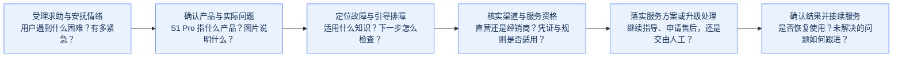
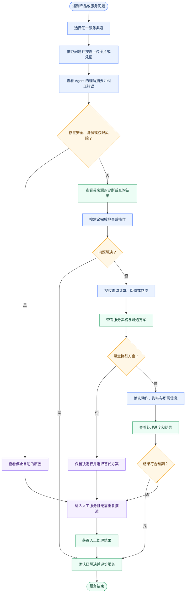

# Anker 智能客服产品方案

> 版本：0.2  
> 日期：2026-09-19  
> 用途：初赛产品方案草稿  
> 数据参考：[Anker Demo 数据源链接](../05-数据资产/2026-09-18-Anker-Demo-数据源链接.md)

## 1. 安克智能服务业务总览与产品要解决的问题

### 1.1 业务总览图

本方案面向安克黑客松「赛道四 · 智能服务：真正听懂，真正解决」。依据赛题提供的情绪化求助、产品名称歧义、故障图片和经销商订单等情境，下图呈现用户从求助到获得服务结果的业务主线。

这条主线以赛题中的设备求助为代表：先理解用户的处境和产品，再提供适用的排障指导，需要售后时继续核实购买渠道与服务资格，最终给出可执行、可跟进的处理结果。用户可以直接提出订单、资格或进度查询，排障解决问题后也可直接结束；出现风险或争议时可随时升级处理。

- **听懂用户：** 用户可能只发一张报错照片，伴随“明天要开派对，机器突然动不了了”的焦虑表达。受理环节需要理解紧迫性、确认具体产品和问题，减少用户的解释负担。
- **帮助解决：** 针对确认后的产品与症状，结合技术知识和可用的历史处理记录给出步骤，并根据用户反馈继续判断。
- **接续服务：** 排障无效、订单查不到或凭证不完整时，继续核实渠道、说明所需信息，并给出后续服务或人工处理路径。

### 1.2 产品要解决的问题

赛题中的安克售后场景有三类突出困难：
1. 用户表达带有情绪且信息不完整；
2. 产品名称、图片与症状可能存在歧义；
3. 购买渠道与售后信息分散，单次查询未必能得到结论。
用户的一次求助，可能同时需要安抚、产品确认、故障排查、渠道核验和人工协作。

例如，赛题用“我的 S1 Pro 不吸了”说明产品消歧问题：仅凭简称和“不吸”这一症状，无法确定用户说的是扫地机器人还是吸尘器。系统需要通过少量关键追问、产品图片或购买信息确认对象，再调用适用的资料。

另一个关键情境是订单查询无结果。用户可能通过经销商购买，系统需要继续核实渠道与凭证，并结合适用规则判断后续服务路径。不能将“当前订单系统未查到”直接等同于“没有购买记录”或“不能获得质保”。

因此，本产品拟以 **AI 智能客服 Agent 与高交互前端**承接求助，结合用户文本、故障图片、技术知识库与可用的历史工单信息，在产品歧义、情绪化表达和多渠道凭证场景下，组织判断、指导与升级处理。前端承载必要追问、图片补充、分步指导、依据展示和处理反馈，让用户知道当前在解决什么、为什么需要补充信息、下一步将发生什么。

## 2. 智能客服：产品架构

产品由 **前端交互页面、Agent 服务应用、工单管理系统、知识库** 四部分组成。前端提供产品页面和售后咨询入口；Agent 承接用户理解、售后咨询与排障；工单管理系统保存需要持续处理的诉求，支持人工接手和后续跟进；知识库提供产品、排障、政策与购买渠道方面的依据。本方案不建设订单交易系统，订单号或购买凭证仅在需要时作为服务诉求的关联信息。

### 2.1 产品架构图

图中前端交互页面、Agent 服务应用与工单管理系统按组成部分展开，知识库按知识域展开；以下说明与图中的名称一一对应。

#### 2.1.1 前端交互页面

前端交互页面包括产品页面和售后咨询 Agent。

#### 2.1.2 Agent 服务应用

Agent 服务应用接收用户的文字和图片，支持产品确认、分步排障与结果反馈，并展示知识来源、工单进度及人工接手状态。LLM 结合提示词、会话上下文和检索资料理解诉求与情绪、识别产品歧义、提取故障线索，组织回复和交接摘要；Workflow 根据当前情况安排追问、知识检索、排障或工单处理，通过 Function Calling 及配套工具函数连接知识库和工单系统，完成检索、建单、记录补充与进度查询。Memory 保存并提供已确认的产品、症状、已尝试步骤、用户反馈、待补信息和关联工单编号，供后续对话继续使用。Constraint 约束回答和工具使用：没有依据时不编造结论，产品未确认时不套用其他型号的排障步骤，出现安全风险时停止相应自助指导。

#### 2.1.3 工单管理系统
工单管理系统围绕“一次需要持续处理的服务诉求”保存信息、协调客服并追踪进展。AI 能当场解决的咨询可以直接结束并保留会话记录；需要人工介入或后续跟进时，创建或关联工单。同一工单可延续多次对话。

##### 客服工作台
人工客服查看和处理工单的入口，包括人工服务对话模块、工单列表、工单详情及沟通区域。客服可以查看产品、问题摘要、AI 已做排障和用户反馈，接单、回复、补充内部备注，并更新处理状态；交接摘要与原始会话关联，便于核对信息。

##### 工单管理模块
依据业务场景展开的工单管理系统，管理系统里承接工单的整个生命周期。方便人工客服和 Agent 对工单按照工单状态对于具体工单进行操作，包括：增删改查、状态更新等。

##### 工单数据库
保存三类业务记录：
- 工单档案记录（用户、产品、问题、当前状态与负责人），用于描述工单信息；
- 处理历史（回复、备注、状态变更与交接记录），用于记录工单当前处理状态，方便工单追踪；
- 关联资料（会话、图片、附件引用及必要购买信息）。

##### 自动化规则配置模块
配置工单处理中的条件和动作，例如状态变更时通知相关人员、长时间无人接单时提醒，以及特定状态变更需要满足的条件。规则由工单管理模块或相应执行逻辑应用；

#### 2.1.4 知识库

知识库提供安克售后咨询所需的可复用知识。知识库模块按照知识域划分为：

##### 产品知识

包括品牌与品类、型号与别名、外观及标签特征、功能、配件兼容性，以及使用和维护说明。用于确认用户求助的产品对象，回答安装、设置、使用和保养问题，避免将相似名称或不同品类的资料混用。

##### 故障与排障知识

包括故障现象、报错码、可能原因、诊断条件、排查步骤、安全注意事项和停止自助的条件。用于结合文本与图片线索选择适用的排障方法，并根据反馈推进判断。

##### 保修与售后政策知识

包括适用产品与地区的保修范围、期限、例外条件、所需材料、可用服务选项和费用说明。用于解释用户可能获得的帮助与待核实事项。

##### 购买渠道与凭证知识

包括购买渠道类型、可获得的经销商名录与服务信息、凭证类型、核验要求，以及订单查不到或凭证不完整时的处理指引。用于指导用户补充材料、识别应联系的服务方。

## 3. User Flow：用户如何使用产品（这部分内容之后要改）

#### 主要角色与任务

- **消费者**：希望少解释、少等待，得到可信且可执行的解决方案。
- **人工客服**：希望接管时已有完整上下文，不再让用户重复描述。
- **服务运营人员**：希望发现共性问题并更新知识、规则和流程，使问题越来越少地重复发生。

#### 消费者主旅程

| 阶段 | 用户目标与行为 | 产品响应 | 关键数据 | 主要判断与分支 |
| --- | --- | --- | --- | --- |
| 1. 发起求助 | 用自然语言或图片描述问题 | 接收消息，显示已理解的信息和当前进度 | 原始消息、渠道、会话 ID | 是否存在立即停止自助的安全风险 |
| 2. 对齐问题 | 回答少量关键问题 | 识别产品、症状、情绪和目标，只追问会改变行动的信息 | 产品候选、症状、缺失槽位 | 信息是否足够；连续理解失败则转人工 |
| 3. 获得方案 | 按步骤排查或查看答案 | 返回适用条件、步骤和可打开的证据来源 | 知识引用、版本、适用范围 | 是否有可靠证据；无证据则拒绝猜测 |
| 4. 验证效果 | 告知问题是否解决 | 记录结果；已解决则结束，未解决则进入业务处理 | 用户反馈、诊断历史 | 已解决 / 仍未解决 / 出现新风险 |
| 5. 获取服务选项 | 提供必要身份或订单信息 | 查询订单、保修、物流与服务资格，解释依据 | 订单、归属、保修、规则结果 | 身份是否通过、是否有资格、是否需人工审批 |
| 6. 决定是否执行 | 查看动作影响并批准、修改或取消 | 展示操作预览和替代方案，等待明确确认 | 操作提案、确认状态 | 批准 / 拒绝 / 超时；未批准不得写入 |
| 7. 获得结果 | 查看办理结果与下一步 | 返回真实业务状态、编号和预期后续 | 工具结果、案例/工单状态 | 成功 / 失败可重试 / 转人工 |
| 8. 确认解决 | 确认目标是否达成 | 关闭任务，或带完整上下文升级 | 服务终态、未解问题 | 已解决 / 有效接管 |

## 4. 初赛实现方案思路

我目前整理了一下，智能客服系统可以作为比赛作品亮点的几个点：
1. 多模态；
2. Agent自己能编排判断当前的任务需要干嘛（是需要调用接口/工具吗？还是查知识库？还是只是闲聊呢？），而不是一个写死的工作流
3. RAG - 向量检索和知识库问答这两个常规实现之外，怎么调整文本切片方式，增加关键词检索，加入重排序，加入一个简单的测试集。
4. Agent 加 Memory -- 记忆模块，而非只是短期记忆
5. 工程细节（.e.g. 模型调用失败怎么办？接口调用重试？）
6. Multi-Agent的协作（根据业务场景下的需求来拆，而不是为了多Agent而多Agent）

### 4.1 技术起点
找到了两个相关项目：
参考项目：[SupportFlow AI](https://github.com/abdullahahsen05/supportflow-ai) 与 [Customer Support Agent](https://github.com/Shaurya856/Customer_Support_Agent)。初赛以其产品思路为参考。

SupportFlow AI 已经搭出了相对完整的客服产品原型，包括消费者聊天页面、客服后台、FastAPI 后端、PostgreSQL 会话与工单数据、ChromaDB 知识检索和 MLflow 运行记录。我们可以参考它的产品形态、前后端结构和基础数据模型，将其作为整个项目的大框架。不过，它目前仍以规则和关键词完成意图分流，历史会话没有真正进入 Agent 的下一轮推理，转人工也主要停留在创建升级工单。因此，它更适合作为 baseline。

Customer Support Agent 更聚焦 Agent 的运行和编排。它使用 LangGraph 组织“模型判断—调用工具—读取工具结果—继续判断”的循环，通过原生 Function Calling 让模型选择工具，并使用 Checkpoint 恢复会话状态；创建工单或升级人工前，还会由代码检查用户是否已经确认。我们可以参考这部分实现，补足 SupportFlow AI 在动态任务判断、工具调用、Memory 和操作门禁上的不足。

所以这样的话我们整个方案的侧重点就是：SupportFlow AI作为我们的骨架（做出一个相对完整的框架），我们拿Customer Support Agent 的Agent编排部分，然后同时聚焦知识库的实现。

相当于是我们有两个主要亮点。

### 4.2 初赛方案范围

初赛方案选择几个代表性故障作为完整演示主线，我们可以去安克网站上针对3-5个产品做一个小的知识库，知识库包括产品介绍、产品图片、供应商渠道信息、凭证和退换政策等。

用户可以输入文字并上传一张图片；系统提取产品候选、型号文字和可见故障线索，存在歧义时先请用户确认。产品确认后，Agent 检索适用知识，每次给出一个可执行的排障步骤，并根据用户反馈继续判断。问题解决后记录结果；仍未解决或出现风险时，创建工单，工单自动录入工单管理系统。并且后台的管理系统可供客服查看订单信息。

初赛方案需要交付以下能力：

- 消费者聊天页面：支持文本、单张图片、追问、知识来源和排障反馈；
- Agent 服务：包含结构化理解、条件 Workflow、Function Calling、会话 Memory 和代码级约束；
- 知识库：包含产品目录、故障与排障知识、混合检索、重排序、来源返回和小型测试集；
- 工单管理系统和对应数据库：Agent 创建工单，客服后台查看列表和详情、读取交接摘要并更新状态；
- 基础运行记录（可选）：保存模型调用、检索结果、工具输入输出、失败原因和最终结果。
