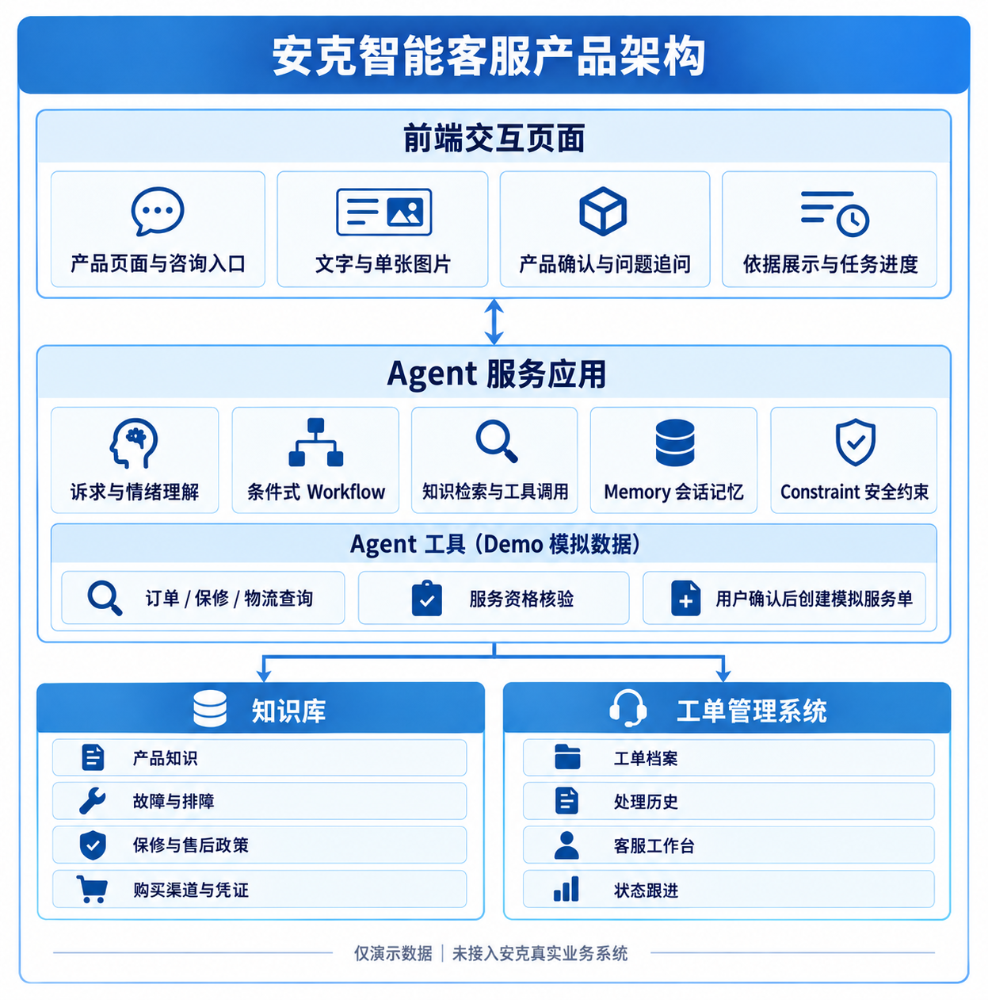
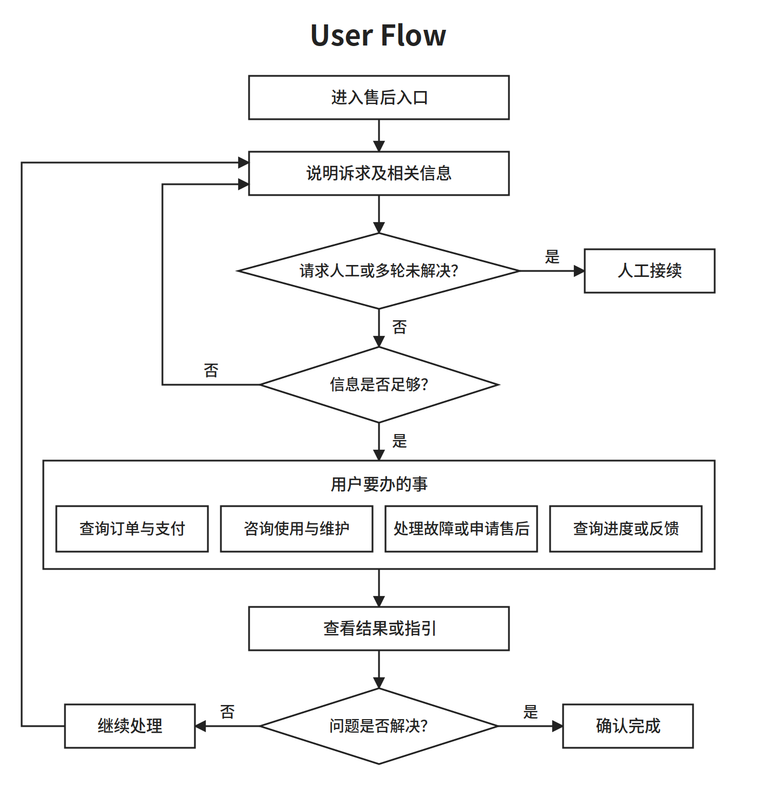

Sep 24, 2026 · @Tian

## 一、预赛信息卡

| 项目 | 填写内容 |
| --- | --- |
| 队名 | 待填写 |
| 意向赛道 | 智能服务 |
| 一句话摘要 | 待填写：用一句话说明服务对象、核心问题和解决方式 |
| 队长信息 | 待填写：姓名、邮箱、手机号 |
| 成员介绍与分工 | 待填写：每位成员的姓名、邮箱及负责工作（共 2–4 人，含队长） |

## 二、方案成果展示

### 1. 赛题理解

#### 1.1 安克的业务与产品线

安克面向消费者的产品分为五条产品线，各线的产品形态和售后问题差异很大，这是本方案设计的起点。[官网](https://www.anker.com.cn/brands)将产品归为 Anker Charging（充电）、Anker SOLIX（能源）、Anker eufy（智能家居）、Anker soundcore（影音）和 Anker eufyMake（创作工具）。安克正将原有品牌统一到 Anker 名下，并说明现有保修、客服和服务不受影响（[品牌整合公告](https://www.anker.com.cn/posts/IFA2026-CN)）。

品牌统一后，用户会从同一个“安克”入口求助，但背后的服务规则并不统一。安克官网说明，大多数产品享有 18 个月硬件质保，售后政策因品类不同而有差异（[联系我们](https://www.anker.com.cn/cooperation)）。能源线差异最明显：日本官网上，会员注册后户外电源的保修可从 18 个月延长到 5 年，太阳能板等部分产品除外（[Anker Japan SOLIX 保修说明](https://www.ankerjapan.com/pages/solix-support)）。这说明产品线和地区都会改变同一个问题的答案。

下表按产品线自上而下拆开，“典型售后问题”是我们根据产品形态做的归纳：

| 产品线 | 典型产品 | 产品形态 | 典型售后问题 |
| --- | --- | --- | --- |
| 充电 | 充电宝、充电器、数据线 | 单价低、购买频次高、渠道多 | 兼容性与充电速度、发热鼓包、换新、渠道与凭证核实 |
| 能源 | 户外电源、阳台光伏、家庭储能 | 单价高、体积大，部分需安装与 App 配置 | 使用安全、App 与固件、安装配置、长保修期的资格确认 |
| 智能家居 | 扫地机器人、安防摄像头 | 联网设备，依赖 App、固件和耗材 | 配网与 App、耗材更换、故障诊断、维修或寄修 |
| 影音 | 耳机、音箱 | 随身设备，型号多、迭代快 | 配对与连接、固件升级、单只耳机或充电盒问题 |
| 创作工具 | UV 打印机、3D 打印机 | 专业设备，依赖耗材与配套软件 | 设备调试、耗材适配、软件工作流、维护保养 |

五条线的差别集中在三处：单价与处理方式（换新还是维修），设备是否联网（能否依赖 App 自助），以及是否涉及安全或安装。智能客服不能用一套话术覆盖它们，必须先确认用户属于哪条产品线、哪个型号。

#### 1.2 各产品线的竞对与售后做法

安克没有一家覆盖全部品类的竞对，真正的竞对要按产品线分别找。下表只列同一产品线内的直接竞对，以及它们公开可见的售后做法：

| 产品线 | 直接竞对 | 公开可见的售后做法 |
| --- | --- | --- |
| 充电 | 绿联 | 官方政策只适用于官方渠道售出的产品，授权第三方平台售出的由经销商处理；保修卡、销售票据和机身 SN 码是保修凭证（[绿联售后服务政策](https://www.lulian.cn/servive1/)） |
| 能源 | 正浩 EcoFlow、Jackery | 服务支持围绕常见问题、用户手册、安装教程和软件下载组织（[正浩官网](https://www.ecoflow.com/cn/home)）；两家与安克在便携储能领域直接竞争（[邦阅网](https://www.52by.com/article/175711)） |
| 智能家居 | 石头、科沃斯 | 支持内容按产品型号组织（[石头支持中心](https://support.roborock.com/hc/en-us)）；可在 App、电话或在线客服报修并上传故障视频，维修分上门和寄修，小城市多为寄修（[第三方对比](https://weibo.com/2/detail/comos:niskyis7205075)） |
| 影音 | 漫步者 | 社区按型号提供排障步骤，例如左右耳重新配对；排障无效时，按购买渠道找官方客服维修或更换（[漫步者社区](https://bbs-pc.edifier.com/post/19286)） |
| 创作工具 | 暂无直接对应 | eufyMake E1 以个人 UV 打印机为定位（[Notebookcheck](https://www.notebookcheck.net/Anker-s-eufyMake-E1-launches-as-world-s-first-personal-UV-printer-with-3D-texture.1099004.0.html)），同类消费级产品少，公开售后资料有限，待补充 |

安克自身的售后也暴露出同样的问题。有用户在线下档口购买充电宝，店铺倒闭后，官方以非授权渠道为由拒绝保修（[黑猫投诉](https://tousu.sina.com.cn/complaint/view/17379939383)）。渠道和凭证能否被核实，直接决定用户能否得到服务。

#### 1.3 可参考与不可参考的售后做法

判断标准是：竞对的做法是信息与流程的组织方式，还是依赖线下网络或设备数据的服务能力。前者可以迁移到一个跨产品线的智能客服里，后者取决于安克各条线自己的服务体系，方案不做假设。

| 竞对做法 | 结论 | 原因与对应设计 |
| --- | --- | --- |
| 按型号组织支持内容（石头、漫步者） | 可参考 | 安克型号多、跨五条线，更需要这样做；对应知识库按产品线和型号限定检索范围 |
| 区分官方与第三方渠道，明确凭证要求（绿联） | 可参考 | 安克同样存在渠道与凭证纠纷；对应订单系统的购买核验 |
| 报修时上传照片或视频（石头、科沃斯） | 可参考 | 能减少来回描述；对应前端的多模态输入 |
| 先按步骤排障，无效再找客服（漫步者） | 可参考 | 与本方案的服务链路一致；对应 Agent 的状态记录和转人工 |
| 上门维修网络（科沃斯、石头） | 不直接参考 | 取决于线下服务网点，且只适用于部分产品线；方案只负责把问题完整交给工单 |
| App 远程诊断设备故障 | 不直接参考 | 需要接入设备运行数据，且只有联网产品具备；可作为智能家居和能源线的后续扩展 |
| 按单一品类制定统一售后规则（绿联） | 不能照搬 | 安克政策因品类和地区而异；知识库中的政策必须带适用条件 |
| 家庭储能的安装与现场服务 | 不在范围内 | 涉及安装商与现场作业，超出对话式服务能解决的范围；遇到时转人工 |

这张表也划定了方案的边界：我们解决的是“听懂问题、找对依据、完整交接”，而不是替代各产品线的维修与安装体系。

#### 1.4 服务范围与核心难点

［配图：售前与售后服务范围，沿用 assets/售前售后服务范围.png］

基于上述分析，本方案聚焦用户购买之后的服务过程，不把“售后”缩窄为故障维修。用户可能要查询订单与配送、确认产品型号、学习使用和维护、了解适配的耗材与配件、排查故障、申请售后，也可能在申请后补充凭证、查询进度或反馈结果。

核心难点有三个，都来自安克的业务特性：

1. 先认准产品。五条产品线所需的知识、排查步骤和安全提醒各不相同，相似名称还可能对应不同型号。不确认产品线和型号，就无法找到适用的资料。
2. 规则随渠道和地区变化。同一个问题，因购买渠道、所在地区不同，适用的售后政策可能不同。线下或经销商渠道购买、查不到平台订单的用户，也需要被告知该补什么凭证。
3. 自助与人工的衔接。用户提供的信息常常不完整，还可能带着焦虑或安全顾虑。Agent 要判断是直接解答、继续追问、查询业务记录，还是停止自助并交给人工，而且交接时不能丢失已知信息。

我们据此理解赛题中的“真正听懂，真正解决”：前者是识别用户要完成的服务任务，并弄清影响判断的关键事实；后者是给出有依据、可执行、能继续跟进的处理结果。对于无法可靠处理的问题，保留已知信息与已尝试步骤，支持人工接续；对于无关问题，说明服务边界，不编造答案。第 2 部分将从这三个难点出发展开设计。

### 2. 具体方案说明（突出 AI 能力）

#### 2.1 产品架构

产品架构图回答的是这个产品能提供哪些能力。方案分为前端交互、Agent 服务应用、知识库、订单系统和工单系统五个部分，各部分按以下原则分工：

- 前端交互负责呈现与确认：用户看到什么、能确认和纠正什么。
- Agent 负责判断与执行：识别任务、决定追问什么、调用哪项能力、何时停止自助处理。
- 知识库负责可复用的规则与资料：产品说明、排障方法、售后政策等，不随具体用户变化。
- 订单系统与工单系统负责具体用户的实时数据：订单、物流、购买核验结果和服务记录，只能通过业务接口查询，不能由知识库推断。

以下五节按一次服务中能力被用到的先后顺序展开。技术组件如何支撑这些能力，见 2.3 时序图。

##### 2.1.1 前端交互

包含能力：多模态输入、型号确认、依据展示、任务进度。

用户可以用文字描述问题，必要时上传产品照片或购买凭证。页面显示当前识别到的产品和型号，遇到简称或型号歧义时，请用户确认或纠正后再继续。

回答旁设置“依据与检索”区域，展示本次查找的资料类别、实际用于回答的来源及相关内容；没有找到足够依据时明确说明，不把推测包装成结论。这里展示的是可核验的检索结果，不是模型内部的推理过程。

页面同时保留当前任务的简要进度，包括已确认的信息、Agent 建议过的步骤、用户实际尝试的步骤及反馈。用户可以纠正记录，避免换一轮对话就从头描述。

##### 2.1.2 Agent 服务应用

包含能力：任务识别、信息追问、工具调度、状态记录、边界判断。

Agent 首先判断用户要完成哪类售后任务，再确认会影响答复的关键信息：产品线、具体型号；涉及服务规则时，还要核对地区和购买渠道。信息不足就追问，不用相似产品的资料直接给出型号专属的排障步骤或政策承诺。

信息明确后，Agent 决定调用知识库、订单系统还是工单系统，并依据返回结果组织下一步。它分别记录“已确认的事实”“给过的建议”“用户说已尝试及其结果”和“仍未解决的问题”，不把建议自动记成已完成。且当证据不足、存在风险或自助处理无效时，Agent 说明原因并进入人工接续；遇到与售后无关的问题，说明服务边界，不编造答案。

##### 2.1.3 知识库

包含能力：按产品线组织知识（充电、能源、智能家居、影音、创作工具），每条产品线内再区分使用维护、故障排查、售后政策等知识类型。

统一服务入口不等于混用知识。知识库先按产品线隔离，再用产品型号、地区及适用版本等信息限定检索范围，避免把某一型号或地区的说明误用于另一款产品。这也是 Agent 必须先确认产品线和型号的原因：确认之前，它不知道该去哪一部分检索。

每条可用于回答的知识保留资料标题、来源链接及适用信息，支持前端展示回答依据。若来源冲突或不适用，Agent 继续核实或说明限制。

待确认：售后政策是按产品线各自维护，还是以通用政策为主、个别产品线例外。这决定它放在每条产品线之下，还是作为共享知识单独成块。

##### 2.1.4 订单系统

包含能力：订单查询、物流追踪、购买核验。

订单查询按订单号或手机号找到用户的订单，返回订单状态、支付状态和所购商品。订单记录中的具体商品，能为 Agent 确认型号提供事实依据，而不只依赖用户口述。

物流追踪返回发货、运输、签收等配送状态及异常件信息。购买核验判断这笔购买能否被核实、来自哪个渠道；核实不了时，告诉用户需要补充哪些凭证。购买核验只确认购买事实，不判断保修资格。

知识库中的“渠道与凭证要求”说明哪种渠道需要什么凭证，是静态规则；购买核验针对这位用户的具体购买做核实，是实时数据。两者分工不同，不重复。

##### 2.1.5 工单系统

包含能力：交接建单、分派流转、人工处理、进度跟进。

自助服务无法解决时，工单承接的是一项尚未完成的任务，而不只是最后一条聊天消息。交接建单把 Agent 的任务状态整理成一张可接手的工单：已确认的产品与问题、查阅过的来源、建议过的步骤、用户实际尝试及其结果、未解决项和仍需补充的材料。用户先核对交接内容，再确认是否建单。

分派流转按规则把工单交给合适的处理方，例如按产品线分组、涉及安全风险时提高优先级、超时升级。人工处理是客服接手工单、处理并更新状态的环节，客服看到的是完整交接记录，不需要重新向用户询问。

进度跟进面向建单之后的用户：查询处理进度、追加凭证或照片、反馈处理结果。用户回到对话中即可沿着原有记录继续，不必重新描述问题。

#### 2.2 用户旅程

这张图只呈现用户在一次售后服务中的动作：进入入口、说明诉求、补充信息、办理事项、查看结果，未解决时继续处理，必要时转人工接续。AI 如何识别任务、调用知识与业务能力，留到 2.3 时序图说明。

#### 2.3 时序图（待补充）

待补充：本节以一次典型售后服务为例，画出前端、Agent、知识库、订单系统和工单系统之间的交互顺序。技术组件不单独罗列，而是出现在它们支撑的交互环节中：

| 技术组件 | 支撑的能力（见 2.1） |
| --- | --- |
| LLM | 任务识别、信息追问、答复组织 |
| Workflow | 追问、查询、转人工等步骤的编排 |
| Function Calling | 工具调度：调用知识库、订单系统、工单系统 |
| Memory | 状态记录：已确认事实、建议、已尝试步骤、未解决项 |
| Constraint | 边界判断：证据不足、存在风险或超出服务范围时的处理 |

待确认：时序图选用哪个典型场景，例如“故障排查无效后转人工建单”。

#### 2.4 实现与演示范围

2.1 至 2.3 的图示表达的是目标架构和目标体验，本节集中说明演示版中哪些部分为真实实现、哪些为模拟。

### 3. 方案价值与预期效果

待补充：说明方案能改善哪些用户体验或服务环节，以及 24 小时开发内可以完成什么样的可演示原型。涉及量化效果时，写明估算依据。

### 4. 方案优势与创新点
