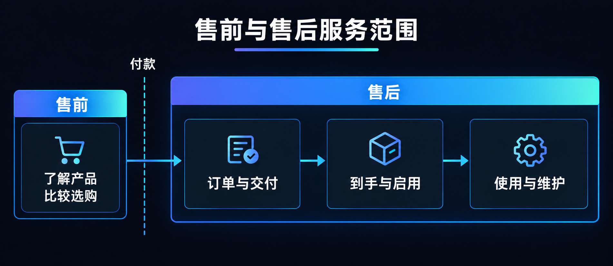
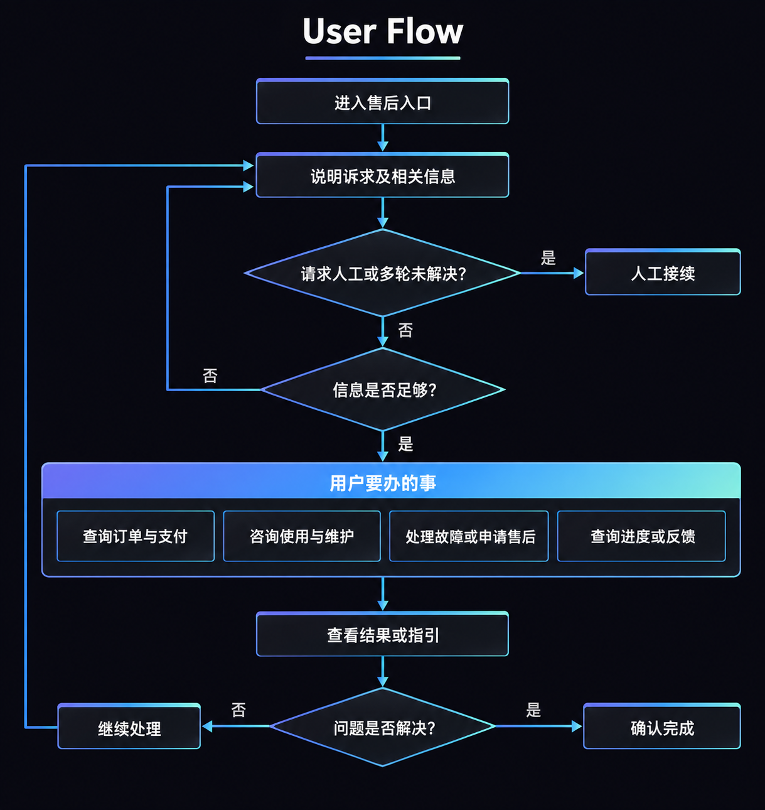
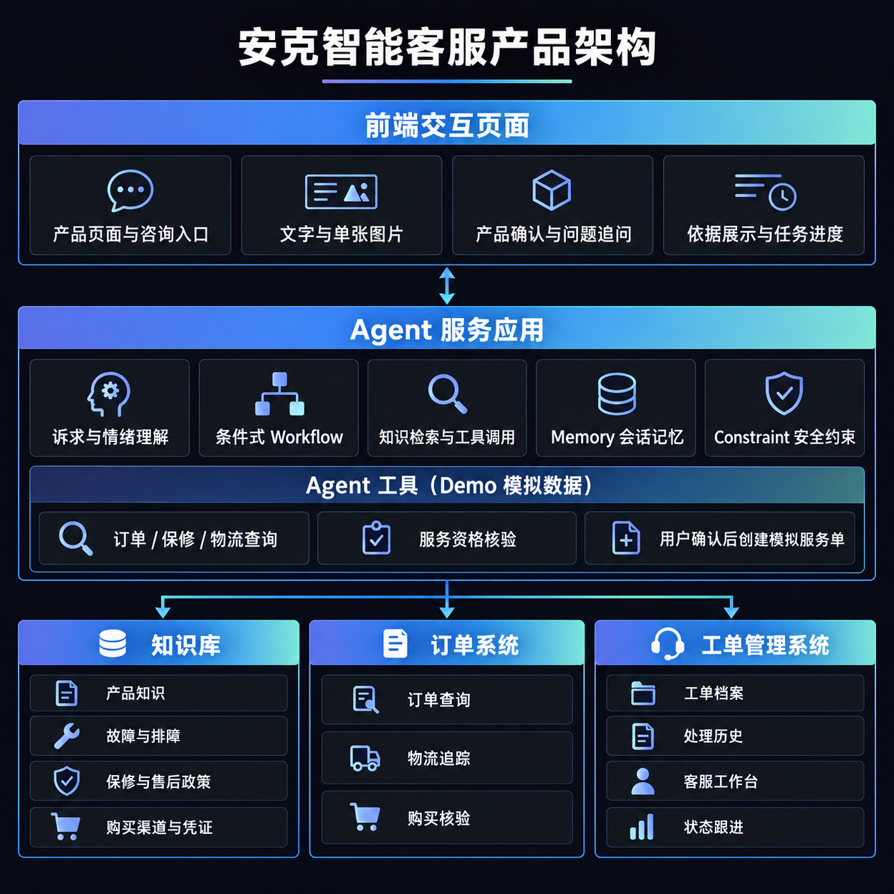
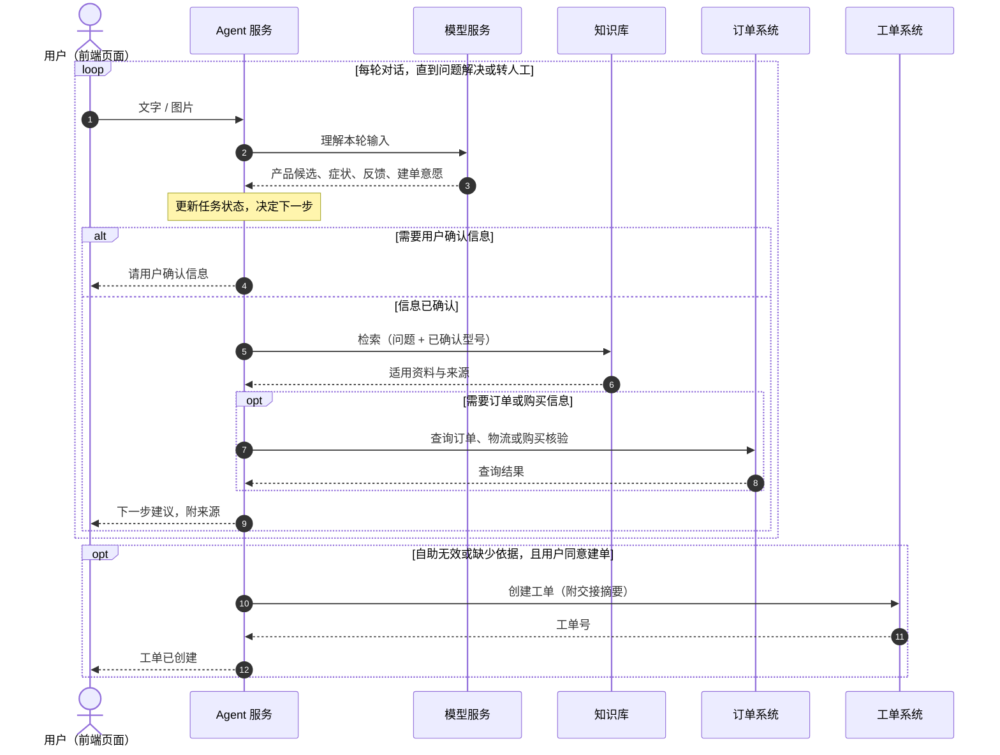

Sep 24, 2026 · @Tian

## 一、预赛信息卡

| 项目 | 填写内容 |
| --- | --- |
| 队名 | 待填写 |
| 意向赛道 | 智能服务 |
| 一句话摘要 | 待填写：用一句话说明服务对象、核心问题和解决方式 |
| 队长信息 | 待填写：姓名、邮箱、手机号 |
| 成员介绍与分工 | 待填写：每位成员的姓名、邮箱及负责工作（共 2–4 人，含队长） |

## 二、方案成果展示

### 1. 赛题理解

#### 1.1 安克的业务与产品线

安克面向消费者的产品分为五条产品线，各线的产品形态和售后问题差异很大，这是本方案设计的起点。[官网](https://www.anker.com.cn/brands)将产品归为 Anker Charging（充电）、Anker SOLIX（能源）、Anker eufy（智能家居）、Anker soundcore（影音）和 Anker eufyMake（创作工具）。安克正将原有品牌统一到 Anker 名下，并说明现有保修、客服和服务不受影响（[品牌整合公告](https://www.anker.com.cn/posts/IFA2026-CN)）。

品牌统一后，用户会从同一个“安克”入口求助，但背后的服务规则并不统一。安克官网说明，大多数产品享有 18 个月硬件质保，售后政策因品类不同而有差异（[联系我们](https://www.anker.com.cn/cooperation)）。能源线差异最明显：日本官网上，会员注册后户外电源的保修可从 18 个月延长到 5 年，太阳能板等部分产品除外（[Anker Japan SOLIX 保修说明](https://www.ankerjapan.com/pages/solix-support)）。这说明产品线和地区都会改变同一个问题的答案。

下表按产品线自上而下拆开，“典型售后问题”是我们根据产品形态做的归纳：

| 产品线 | 典型产品 | 产品形态 | 典型售后问题 |
| --- | --- | --- | --- |
| 充电 | 充电宝、充电器、数据线 | 单价低、购买频次高、渠道多 | 兼容性与充电速度、发热鼓包、换新、渠道与凭证核实 |
| 能源 | 户外电源、阳台光伏、家庭储能 | 单价高、体积大，部分需安装与 App 配置 | 使用安全、App 与固件、安装配置、长保修期的资格确认 |
| 智能家居 | 扫地机器人、安防摄像头 | 联网设备，依赖 App、固件和耗材 | 配网与 App、耗材更换、故障诊断、维修或寄修 |
| 影音 | 耳机、音箱 | 随身设备，型号多、迭代快 | 配对与连接、固件升级、单只耳机或充电盒问题 |
| 创作工具 | UV 打印机、3D 打印机 | 专业设备，依赖耗材与配套软件 | 设备调试、耗材适配、软件工作流、维护保养 |

五条线的差别集中在三处：单价与处理方式（换新还是维修），设备是否联网（能否依赖 App 自助），以及是否涉及安全或安装。智能客服不能用一套话术覆盖它们，必须先确认用户属于哪条产品线、哪个型号。

#### 1.2 各产品线的竞对与售后做法

安克没有一家覆盖全部品类的竞对，真正的竞对要按产品线分别找。下表只列同一产品线内的直接竞对，以及它们公开可见的售后做法：

| 产品线 | 直接竞对 | 公开可见的售后做法 |
| --- | --- | --- |
| 充电 | 绿联 | 官方政策只适用于官方渠道售出的产品，授权第三方平台售出的由经销商处理；保修卡、销售票据和机身 SN 码是保修凭证（[绿联售后服务政策](https://www.lulian.cn/servive1/)） |
| 能源 | 正浩 EcoFlow、Jackery | 服务支持围绕常见问题、用户手册、安装教程和软件下载组织（[正浩官网](https://www.ecoflow.com/cn/home)）；两家与安克在便携储能领域直接竞争（[邦阅网](https://www.52by.com/article/175711)） |
| 智能家居 | 石头、科沃斯 | 支持内容按产品型号组织（[石头支持中心](https://support.roborock.com/hc/en-us)）；可在 App、电话或在线客服报修并上传故障视频，维修分上门和寄修，小城市多为寄修（[第三方对比](https://weibo.com/2/detail/comos:niskyis7205075)） |
| 影音 | 漫步者 | 社区按型号提供排障步骤，例如左右耳重新配对；排障无效时，按购买渠道找官方客服维修或更换（[漫步者社区](https://bbs-pc.edifier.com/post/19286)） |
| 创作工具 | 暂无直接对应 | eufyMake E1 以个人 UV 打印机为定位（[Notebookcheck](https://www.notebookcheck.net/Anker-s-eufyMake-E1-launches-as-world-s-first-personal-UV-printer-with-3D-texture.1099004.0.html)），同类消费级产品少，公开售后资料有限，待补充 |

安克自身的售后也暴露出同样的问题。有用户在线下档口购买充电宝，店铺倒闭后，官方以非授权渠道为由拒绝保修（[黑猫投诉](https://tousu.sina.com.cn/complaint/view/17379939383)）。渠道和凭证能否被核实，直接决定用户能否得到服务。

#### 1.3 可参考与不可参考的售后做法

判断标准是：竞对的做法是信息与流程的组织方式，还是依赖线下网络或设备数据的服务能力。前者可以迁移到一个跨产品线的智能客服里，后者取决于安克各条线自己的服务体系，方案不做假设。

| 竞对做法 | 结论 | 原因与对应设计 |
| --- | --- | --- |
| 按型号组织支持内容（石头、漫步者） | 可参考 | 安克型号多、跨五条线，更需要这样做；对应知识库按产品线和型号限定检索范围 |
| 区分官方与第三方渠道，明确凭证要求（绿联） | 可参考 | 安克同样存在渠道与凭证纠纷；对应订单系统的购买核验 |
| 报修时上传照片或视频（石头、科沃斯） | 可参考 | 能减少来回描述；对应前端的多模态输入 |
| 先按步骤排障，无效再找客服（漫步者） | 可参考 | 与本方案的服务链路一致；对应 Agent 的状态记录和转人工 |
| 上门维修网络（科沃斯、石头） | 不直接参考 | 取决于线下服务网点，且只适用于部分产品线；方案只负责把问题完整交给工单 |
| App 远程诊断设备故障 | 不直接参考 | 需要接入设备运行数据，且只有联网产品具备；可作为智能家居和能源线的后续扩展 |
| 按单一品类制定统一售后规则（绿联） | 不能照搬 | 安克政策因品类和地区而异；知识库中的政策必须带适用条件 |
| 家庭储能的安装与现场服务 | 不在范围内 | 涉及安装商与现场作业，超出对话式服务能解决的范围；遇到时转人工 |

这张表也划定了方案的边界：我们解决的是“听懂问题、找对依据、完整交接”，而不是替代各产品线的维修与安装体系。

#### 1.4 服务范围与核心难点

基于上述分析，本方案聚焦用户购买之后的服务过程，不把“售后”缩窄为故障维修。用户可能要查询订单与配送、确认产品型号、学习使用和维护、了解适配的耗材与配件、排查故障、申请售后，也可能在申请后补充凭证、查询进度或反馈结果。

核心难点有三个，都来自安克的业务特性：

1. 先认准产品。五条产品线所需的知识、排查步骤和安全提醒各不相同，相似名称还可能对应不同型号。不确认产品线和型号，就无法找到适用的资料。
2. 规则随渠道和地区变化。同一个问题，因购买渠道、所在地区不同，适用的售后政策可能不同。线下或经销商渠道购买、查不到平台订单的用户，也需要被告知该补什么凭证。
3. 自助与人工的衔接。用户提供的信息常常不完整，还可能带着焦虑或安全顾虑。Agent 要判断是直接解答、继续追问、查询业务记录，还是停止自助并交给人工，而且交接时不能丢失已知信息。

我们据此理解赛题中的“真正听懂，真正解决”：前者是识别用户要完成的服务任务，并弄清影响判断的关键事实；后者是给出有依据、可执行、能继续跟进的处理结果。对于无法可靠处理的问题，保留已知信息与已尝试步骤，支持人工接续；对于无关问题，说明服务边界，不编造答案。第 2 部分将从这三个难点出发展开设计。

### 2. 具体方案说明（突出 AI 能力）

#### 2.1 产品方案

##### 2.1.1 用户旅程

用户进入售后入口后，用文字或图片说明诉求，并按提示补充产品、订单或故障信息。信息齐备后，用户可查询订单与支付、咨询使用与维护、处理故障或申请售后，以及查询进度或反馈结果。用户查看处理结果或操作指引后，若问题已解决则确认完成；若仍未解决，则补充情况并继续处理。用户主动要求人工协助，或多轮处理后仍未解决时，经用户确认，将已知信息与处理记录一并交给人工接续。

##### 2.1.2 产品架构

安克智能客服面向五条产品线，将订单查询、使用维护咨询、故障排查和售后跟进集中在同一对话入口。用户通过前端用文字或图片说明诉求，Agent 识别任务、追问缺失信息，并协调知识库、订单系统和工单系统推进处理。前端展示回答依据、任务进度和待确认事项，用户可以随时补充或纠正信息。

处理任务时，Agent 从知识库获取使用维护、故障排查及售后政策，从订单系统查询订单、支付、商品和物流信息，再结合查询结果给出答复或操作指引。知识检索按已确认的产品线、型号、地区和版本限定范围，并保留资料来源。用户补充的信息、系统给出的建议、实际尝试及反馈持续记录在当前任务中，作为下一步处理的依据。

证据不足、存在风险或自助处理无效时，Agent 将当前任务中的产品信息、问题、处理记录和待解决项整理为工单，经用户核对确认后交给人工。工单按产品线和处理规则分派，涉及安全风险时提高优先级，超时则升级。客服沿用已有记录接续处理并更新状态，用户仍可在原对话中补充材料、查询进度和反馈结果。

#### 2.2 技术实现

##### 2.2.1 技术选型

| 模块 | 技术方案与用途 | 当前实现 |
| --- | --- | --- |
| 前端交互 | Web 页面通过 HTTP 与后端通信，呈现回复、引用来源和任务进度；通用对话采用 SSE 流式输出。 | 已有文本交互；S1 Pro 演示支持单张图片输入、来源和排障进度展示。 |
| Agent 服务应用 | Python、FastAPI 承接会话与业务请求，LangChain 对接模型。结构化输出提取用户信息，任务状态保存处理进展。 | 通用客服由模型选择工具；S1 Pro 演示由状态机控制型号确认、排障反馈和建单确认。 |
| 知识库 | MySQL 保存知识原文、来源和适用型号；BGE-M3 生成向量，Milvus 执行语义检索。 | 已实现向量召回、相似度阈值过滤和正文一致性校验；S1 Pro 在召回后按型号筛选。检索前分域、混合召回和重排属于方案设计。 |
| 订单系统 | 通过工具函数提供订单、商品和物流查询，供 Agent 获取业务信息。 | 查询结果为模拟数据，尚未接入真实订单系统。 |
| 工单系统 | MySQL 保存工单与交接摘要，客服查看页读取同一份记录。 | 已实现本地建单和查看，尚未接入安克客服系统。 |

模型通过云端接口调用，MySQL 和 Milvus 通过 Docker Compose 在本地运行。任务调度、状态管理和知识检索机制见 2.2.3。

##### 2.2.2 时序图

图中，Agent 服务负责衔接前端与各后端系统，系统之间通过请求与响应交换信息：

| 调用方向 | 请求内容 | 响应内容 |
| --- | --- | --- |
| 前端 → Agent 服务 | 用户输入的文字或图片 | 待确认信息、答复与来源，或建单结果 |
| Agent 服务 → 模型服务 | 本轮输入的理解请求 | 产品候选、症状、反馈和建单意愿 |
| Agent 服务 → 知识库 | 问题与已确认型号 | 适用资料及来源 |
| Agent 服务 → 订单系统 | 订单、物流或购买核验请求 | 对应的业务查询结果 |
| Agent 服务 → 工单系统 | 建单请求与交接摘要 | 工单号 |

调用顺序上，模型服务先返回理解结果，Agent 再按任务状态发起所需查询，并在收到查询结果后汇总回复前端。建单请求须在用户确认后发出，工单系统返回工单号后，Agent 才向前端返回建单成功的消息。

##### 2.2.3 关键技术设计

###### 工具调度与权限控制

Agent 通过 Function Calling 选择订单、商品、物流、知识查询或建单工具。执行前由服务端校验参数、用户身份和操作权限，并检查型号是否确认、用户是否同意建单等前置条件。

订单和工单系统计划通过 MCP 接入，由各业务服务校验会话身份与数据权限。操作范围如下：

| 操作范围 | 执行规则 |
| --- | --- |
| 检索知识、查询当前用户的订单和物流 | 校验通过后自动执行 |
| 创建工单、追加凭证 | 用户明确确认后执行 |
| 退款、修改订单、批准保修资格、关闭工单 | 不授予 Agent 权限，整理信息转人工 |
| 查询其他用户的数据 | 拒绝请求，不返回数据 |

###### 任务状态与人工交接

任务状态分别保存已确认事实、建议步骤、实际尝试、用户反馈和未解决事项；图片线索单独标注为待核实。Agent 每轮更新这份记录，据此继续追问、检索或处理。

转人工时，从任务状态生成交接摘要，附上产品型号、原始诉求、症状、处理经过、图片线索和引用来源，经用户确认后建单。同一会话复用已有工单号，避免重复建单。

###### 知识整理与检索

资料按标题层级和完整句子切分，保留章节路径、表格表头、来源及适用信息。历史会话也可作为补充来源：抽取的问答须与原对话逐字对应，过滤识别出的手机号、订单号，以及失败回复、模拟数据和疑似提示注入内容，再与已有知识去重、合并；无法可靠判断时转人工审核。

整理后的正文和来源保存在 MySQL，向量及内容哈希保存在 Milvus。入库先记录“待向量化”，向量写入后再标记完成，导入中断可续跑。检索结果通过内容哈希核对正文是否与向量一致，未同步的内容不用于回答。

检索范围由已确认的产品信息决定。知识统一存储，按产品线组织，并标注通用、品类或型号等适用范围；型号确认后，检索该型号、所属品类及适用的通用资料，涉及政策时进一步匹配地区等条件。服务端先按这些字段限定范围，再执行向量检索；型号未确认时，只使用产品身份信息帮助澄清。

在限定范围内，BGE-M3 稠密向量负责语义召回，BM25 补充型号、错误码等关键词匹配；合并为 Top 30 候选后，经重排模型选出 Top 5，再按知识域的相关性阈值过滤。阈值在校准集上以零误召回为约束选择，并用独立留出集验证。最终从 MySQL 读取正文，返回带官方来源的资料；没有足够依据时提示用户并提供人工接续入口。

##### 2.2.4 实现与演示范围

当前演示聚焦 S1 Pro（T2080）吸力变弱，已实现型号确认、知识检索、排障反馈、确认建单及本地工单查看。S1 Pro 由状态机触发检索和建单；通用客服由模型选择工具，每轮最多执行一个。通用工具和 S1 Pro 检索经过执行器校验参数、控制超时，并对暂时性故障重试一次；S1 Pro 建单直接调用工单存储逻辑。

S1 Pro 检索目前采用 BGE-M3 稠密向量召回 Top 20，再筛选已确认型号、相似度达标且带官方来源的资料，并校验正文一致性。检索前分域、BM25 混合召回、重排及按知识域校准阈值尚未实现。订单、商品和物流查询使用模拟数据，工单保存在本地，尚未接入安克业务系统；MCP 接入与会话身份权限校验也属于后续设计。

### 3. 方案价值与预期效果

待补充：说明方案能改善哪些用户体验或服务环节，以及 24 小时开发内可以完成什么样的可演示原型。涉及量化效果时，写明估算依据。

### 4. 方案优势与创新点
