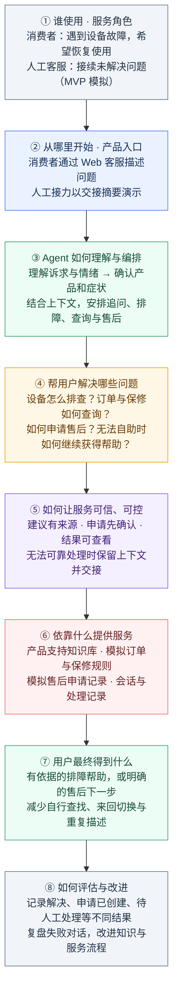
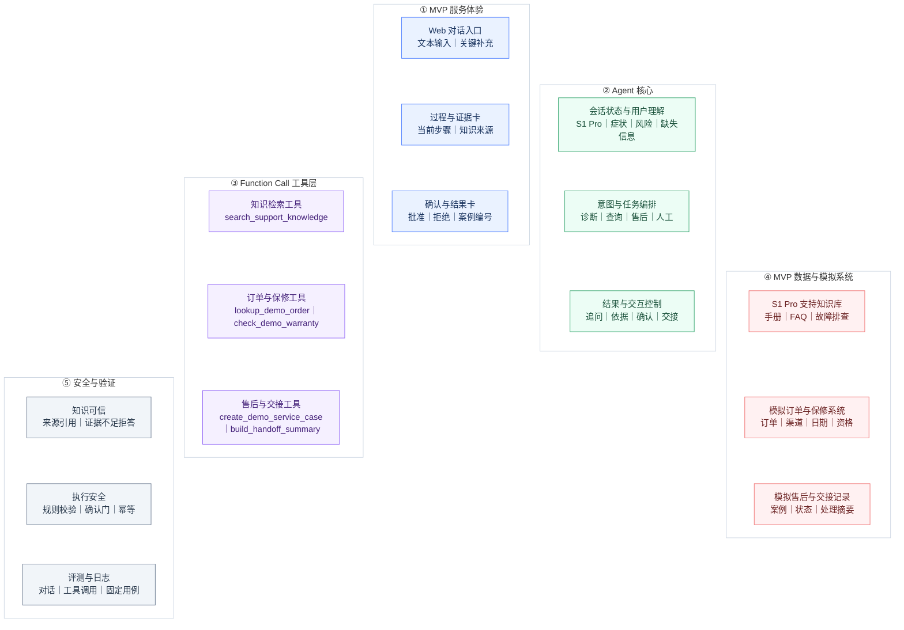
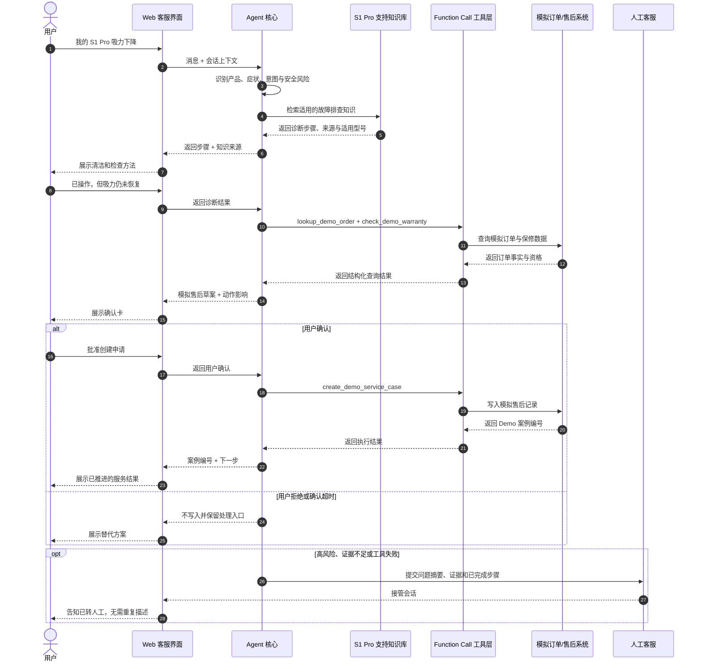
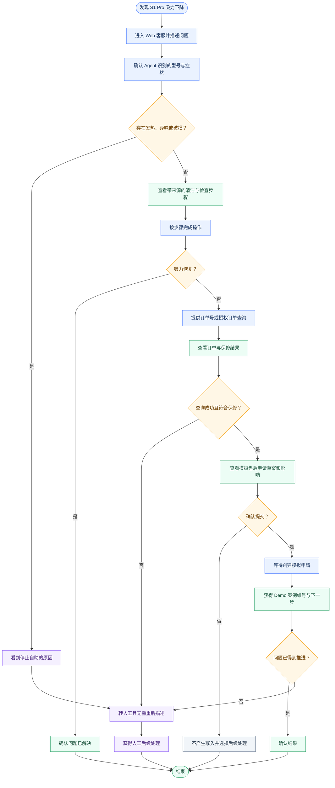

> 历史草稿：当前统一方案见 [智能客服产品方案](../2026-09-19-Anker智能客服产品方案.md)。本文件保留早期范围讨论与实现笔记，不作为当前提交口径。

# Anker 智能服务 MVP 方案

> 版本：0.1  
> 日期：2026-09-19  
> 状态：黑客松 MVP 产品与实现方案  
> 完整目标态：[Anker 智能服务完整版本（目标态）方案](./2026-09-19-Anker智能服务完整版本方案.md)  
> 数据参考：[Anker Demo 数据源链接](../../05-数据资产/2026-09-18-Anker-Demo-数据源链接.md)

## 0. 文档目的

本文独立定义黑客松 MVP：用一个产品、一个主故障、一条端到端主链和一个受控写入动作，证明 Agent 不只会回答问题，还能将售后求助推进到可验证结果。

文档从业务流程、产品能力、系统交互和用户旅程四个视角定义 MVP，并给出实现思路、数据真实性规则、验收标准与不做范围。完整平台的长期能力边界不在本文展开，参见独立的完整版本方案。

MVP 北极星结果是：**用户完成有依据的排障，或在明确授权后获得模拟售后案例；异常情况下携带完整上下文进入人工接管。**

---

## 1. MVP 产品方案

MVP 不尝试缩小复刻完整平台，而是选择一条能同时证明用户理解、知识诊断、业务工具、受控写入和人工接管的端到端故事。实现原则是：**一个产品、一个主故障、一条主链、一个受控写入动作、若干明确失败分支。**

### 1.1 智能客服：要解决什么问题

#### 产品要解决的问题

消费者购买产品后，可能需要了解使用方法、解决异常、核实购买与保修资格、办理维修或退换、查询服务进度，以及寻求人工帮助。这些需求往往交织在同一次求助中：用户未必说得清具体型号，也未必知道该先排障、查订单还是申请售后。

产品希望通过统一的服务入口，理解用户当前的问题和目标，连接产品知识、购买记录与售后流程，让用户获得适用的帮助、明确的处理结果和可继续跟进的下一步。下面按售后全过程梳理主要问题，作为产品能力规划的基础；实际出现频率和优先级仍需通过用户反馈与案例验证。

问题领域 | 用户可能遇到的问题 | 产品需要提供的帮助 |
| --- | --- | --- |
| 诉求表达与情绪理解 | 不知道如何描述问题，只说“不能用了”；带着焦虑、抱怨求助，或用图片展示异常 | 理解目标与情绪，从文本、图片等信息中提取线索，只追问影响处理的关键信息 |
| 产品识别与消歧 | 只记得产品简称，不清楚型号；同名或相似产品导致答非所问 | 结合型号、外观、标签、订单与上下文确认产品，匹配适用资料 |
| 使用与维护咨询 | 不会安装、配对、设置或清洁；不确定配件是否兼容、是否需要更新 | 提供适用型号的使用指导、维护说明与知识来源 |
| 异常诊断与安全处理 | 不知道是操作、环境、耗材还是设备故障；不清楚能否继续使用 | 引导排查，记录已尝试步骤，识别需要停止自助或升级处理的情况 |
| 订单、渠道与购买凭证 | 订单号丢失、系统查不到订单；从经销商或第三方平台购买；凭证不完整 | 核实购买渠道和记录，指导补充凭证，识别应联系的服务方；查不到订单不直接等于无售后资格 |
| 保修与服务资格 | 不清楚是否在保、哪些情况适用、跨地区购买如何处理、是否需要付费 | 结合产品、购买信息、地区与适用规则解释服务选项、费用依据及待核实信息 |
| 售后方案选择与申请 | 不知道该维修、换货、退货退款还是补发配件；不清楚所需材料和办理步骤 | 说明可用方案、条件和影响，收集必要信息，经用户确认后提交允许的申请 |
| 寄送、物流与履约进度 | 不知道如何寄修、谁承担费用；寄出后不清楚是否收件、维修完成或换新发出 | 提供寄送要求，查询物流、维修、换货及退款进度，说明异常和下一步 |
| 申请变更与持续跟进 | 需要补材料、修改信息或取消申请；重复申请；处理后问题仍然存在 | 延续已有服务记录，在规则允许范围内处理变更、补充或重新排查，避免每次重新开始 |
| 投诉、争议与人工接续 | 不认可诊断、资格或费用结论；多次自助失败；转人工后又要重述问题 | 解释依据，提供复核与人工渠道，携带问题摘要、已做步骤和未解事项交接 |

这些问题还对应两类服务侧需求：人工客服需要迅速了解用户情况和已完成的处理，继续解决剩余问题；服务运营人员需要从对话与处理结果中发现重复问题、知识缺口和流程障碍，持续改进服务。

本图按“角色 → 入口 → 理解与编排 → 业务帮助 → 可信保障 → 数据支撑 → 用户结果 → 持续改进”自上而下阅读。



| 
#### 上述问题与当前 MVP 的关系

上述清单描述整个售后场景的问题范围。当前 MVP 选择其中的**文本诉求理解、产品确认、知识排障、模拟订单与保修查询、确认后创建模拟售后申请、交接摘要**进行验证，使用 S1 Pro 吸力下降作为演示案例。

图片理解、经销商与凭证核验、真实维修退换退款、寄送物流跟踪、申请变更和完整投诉处理均属于后续能力候选，尚未纳入当前实现承诺。问题范围在此完整列出，后续再逐项决定哪些进入 MVP、哪些延后。

#### 如何理解这张图

- **服务对象与入口**：消费者通过 Web 客服发起求助。人工客服作为后续服务的接力角色展示；MVP 用交接摘要模拟这一环节，尚无真实客服工作台。
- **核心服务能力**：Agent 结合用户表达和会话上下文，安排必要的追问、知识排障、订单与保修查询、售后申请及异常交接。
- **支撑与保障**：知识库提供产品依据，模拟业务系统提供订单事实和申请记录；用户可以查看来源、确认申请、了解处理结果。
- **用户价值与评估**：让用户少查找、少切换、少重复描述。评估时分别记录“问题已解决”“模拟申请已创建”“待人工处理”，避免将申请创建或交接当作设备已修好。

S1 Pro 吸力下降是当前演示案例，用于验证上述能力。具体判断条件、取消、失败和重试路径在后续 User Journey 与系统时序图中展开。本图不增加新的 MVP 功能范围。

### 1.2 智能客服：整个产品包含哪些组件？



#### MVP 能力清单

| 层级 | MVP 模块 | 必须做到 | 明确简化 |
| --- | --- | --- | --- |
| 单一体验层 | Web 对话界面 | 文本对话；显示当前步骤、证据、工具状态、确认卡、模拟标识和最终结果 | 不做 App、IM、邮件、语音和独立客服/运营后台 |
| Agent 核心层 | 用户理解、会话状态、意图与任务编排、结果控制 | 识别产品/症状/情绪；保存节点和槽位；在诊断、查询、确认、写入、转人工间显式切换 | 单 Agent 加显式工作流；不做多 Agent 自由协作和长期记忆 |
| 专业处理层 | S1 Pro 故障诊断处理器、订单/保修处理器、售后申请处理器 | 将业务问题转为知识查询、工具参数或操作提案 | 只覆盖一个主产品和吸力下降主故障，不做全品类 |
| 知识服务 | 支持库、检索与引用 | 检索 S1 Pro 官方公开支持资料，返回来源、适用产品和片段 | 小规模精炼知识，不建设通用知识平台 |
| 行动与规则层 | `lookup_demo_order`、`check_demo_warranty`、`create_demo_service_case`、人工交接摘要 | 查询走确定性工具；模拟写入前校验规则和确认；工具失败不得假装成功 | Function Call 采用统一抽象，但只实现主故事所需工具 |
| MVP 数据层 | 产品知识、诊断步骤、模拟订单、模拟保修规则、模拟售后案例、会话状态 | 区分公开真实来源、团队整理内容和合成业务数据 | 不接 Anker/eufy 真实订单、CRM、物流或售后系统 |
| 最小可观测层 | 对话日志、节点变化、知识引用、工具调用、确认和结果 | 可重放主流程和失败流程，支持固定 Eval 用例 | 不做生产级监控、运营报表和自动优化平台 |

#### Function Call 的产品定位

Function Call 是 Agent 核心与业务能力之间的**统一调用契约**，不是一个独立业务功能。写一个工具和写多个工具会复用同一套注册、参数校验、状态回传和日志机制，因此 MVP 不应为了“少写工具”把所有动作塞进一个万能接口。

MVP 至少拆分三个工具：

| 工具 | 类型 | 输入 | 输出 | 控制要求 |
| --- | --- | --- | --- | --- |
| `lookup_demo_order` | 只读 | 模拟订单号/用户校验字段 | 产品、购买日期、渠道、订单状态 | 身份不匹配时不得泄露详情 |
| `check_demo_warranty` | 只读纯函数 | 产品、购买日期、Demo 规则版本 | 是否符合、理由、可选后续 | 规则结果不可由模型随意改写 |
| `create_demo_service_case` | 低风险模拟写入 | 订单、问题摘要、证据、确认令牌、幂等键 | 模拟案例编号与状态 | 必须确认；重复执行不得重复创建 |

知识检索不是订单查询：前者用于解释性资料和证据，后者必须读取结构化事实。二者不能共用一个向量库来“猜”结果。

### 1.3 组件之间如何交互？



#### MVP 参与组件

1. 用户；
2. Web 客服界面；
3. 单一 Service Agent（含会话状态与显式编排）；
4. 支持知识服务；
5. Demo 订单与售后工具服务；
6. 模拟订单/案例数据；
7. 模拟人工客服接管端点；
8. 事件日志与 Eval 记录。

#### 快乐路径时序

1. 用户提交“我的 S1 Pro 吸力变弱了”。
2. Web 界面将消息和会话 ID 发送给 Service Agent。
3. Agent 识别产品和故障意图；若关键产品或症状不明确，只追问会改变处理路径的信息。
4. Agent 先检查安全风险；无风险后调用支持知识服务。
5. 知识服务返回适用条目、证据片段和来源 URL；Agent 组织为分步排查建议。
6. 用户反馈排查后仍未解决；Agent 进入订单/保修节点。
7. Agent 调用 `lookup_demo_order` 和 `check_demo_warranty`，得到模拟事实与规则理由。
8. Agent 生成创建模拟售后申请的操作提案；Web 显示将写入的内容、模拟标识和确认/取消按钮。
9. 用户确认后，Agent 携带确认令牌和幂等键调用 `create_demo_service_case`。
10. 工具服务再次校验规则和确认，写入模拟案例数据并返回案例编号。
11. Web 展示结果和下一步，Agent 询问是否已获得可接受的解决结果。
12. 全过程的节点、证据、工具、确认和结果写入事件日志。

#### 异常路径时序要求

- **高风险信号**：停止普通排查，输出保守安全提示并生成模拟人工交接，不继续调用售后写入。
- **知识证据不足或冲突**：不生成确定性维修结论，说明限制并转人工。
- **订单不匹配或不符合 Demo 资格**：不泄露详情、不伪造批准；显示理由与人工选项。
- **用户取消或确认过期**：不调用写入工具，保留继续排查或转人工选项。
- **工具超时或失败**：保持“未办理”状态，可重试一次；仍失败则转人工，并把失败原因写入交接摘要。
- **重复确认或请求重放**：幂等键命中已有案例，返回同一案例，不重复创建。

### 1.4 User Journey



#### MVP 用户旅程与判断分支

| 阶段 | 用户目标/感受 | 用户行为 | 产品响应 | 判断分支 |
| --- | --- | --- | --- | --- |
| 1. 求助 | 希望快速恢复吸力，不知道该查哪里 | 描述“S1 Pro 吸力下降” | 识别产品、症状和情绪，显示正在定位问题 | 产品是否明确；是否出现异常发热、异味等高风险信号 |
| 2. 澄清 | 不想填写长表单 | 回答一到两个关键问题 | 解释为什么要问，只收集会改变行动的信息 | 信息足够则继续；连续理解失败则转人工 |
| 3. 排障 | 希望得到可信、可执行的步骤 | 查看来源并按步骤操作 | 展示适用 S1 Pro 的公开知识依据与分步建议 | 证据是否充分；不充分则转人工 |
| 4. 验证 | 判断设备是否恢复 | 反馈“好了”或“仍然不行” | 已恢复则结束；未恢复则建议查询订单/保修 | 已解决 / 未解决 / 出现新风险 |
| 5. 查询资格 | 想知道能否获得售后支持 | 提供模拟订单号和必要验证信息 | 查询模拟订单，显示模拟标识、保修结论和理由 | 订单归属是否通过；是否符合 Demo 资格；工具是否可用 |
| 6. 做出决定 | 希望控制系统下一步做什么 | 查看申请预览，选择确认或取消 | 明示不会触发真实售后，等待明确确认 | 确认则执行；取消/超时则绝不写入 |
| 7. 获得结果 | 希望知道下一步与处理凭证 | 查看模拟案例编号 | 返回模拟处理结果、后续说明和人工选项 | 创建成功 / 失败重试 / 转人工 |
| 8. 结束或接管 | 希望不用重复解释 | 确认是否接受当前结果 | 标记已解决，或携带完整摘要模拟转人工 | 已解决 / 已被有效接管 |

#### Journey 中必须保留的产品体验

- **少问**：每个追问都能说明“这条信息会改变什么”。
- **有据**：诊断建议显示来源和适用型号，而不是只给自然语言答案。
- **可见**：用户能看见正在查知识、查模拟订单、等待确认还是转人工。
- **可控**：创建模拟申请前可预览、确认或取消；未确认时无写入。
- **不重述**：转人工摘要包含产品、症状、已尝试步骤、证据、订单/资格结果和转交原因。
- **真结束**：创建申请并不自动算“设备已修好”；终态必须区分“问题已解决”和“已有明确后续处理”。

---

## 2. 与完整版本的取舍

| 维度 | 完整版本 | MVP | 取舍理由 |
| --- | --- | --- | --- |
| 用户与角色 | 消费者、人工客服、知识/规则/质量运营人员 | 以消费者为主，人工与运营能力用最小界面或事件表示 | 先验证核心价值，不先建设三套后台 |
| 渠道 | Web、App、IM、邮件、语音 | 单一 Web 文本入口 | 避免渠道适配稀释主链 |
| 产品范围 | 多品类、多产品、多故障和完整服务生命周期 | S1 Pro 吸力下降主故障 | 让知识和诊断深度可验证 |
| Agent | 可扩展编排与多个业务域服务 | 单 Agent + 显式状态机/工作流 | 避免为多 Agent 而多 Agent |
| 知识 | 内容采集、审核、版本、检索和引用平台 | 少量人工整理的公开支持知识 | 数据量小，先保证证据质量与适用范围 |
| 业务系统 | 真实订单、物流、保修、CRM、工单与服务系统 | 本地 JSON/轻量数据库和确定性规则 | 无真实内部接口，保证 Demo 可重放 |
| 执行动作 | 多类查询、预约、工单、退换、退款等受控执行 | 查询模拟订单/保修；确认后创建模拟售后申请 | 用一个写入动作验证安全边界 |
| 人工协作 | 真实队列、技能路由、接管工作台、结果回流 | 生成结构化交接摘要并模拟接管 | 验证信息不丢失，不建设客服平台 |
| 评测运营 | 在线指标、告警、Bad Case、版本发布和反馈闭环 | 10–12 条固定测试 + 事件轨迹 | 足以证明行为可解释和可回归 |

MVP 与完整版本共享的是**交互原则和模块契约**，不是生产级基础设施。MVP 成功后，再逐步替换模拟业务系统、增加产品与渠道、建设运营能力；不需要为了未来复用而提前拆微服务。

## 3. MVP 实现思路

### 3.1 推荐实现形态

采用一个可本地运行的 Web 应用和一个后端服务：

```text
Web 对话界面
  └─ 单一 Service Agent
       ├─ 会话状态与显式工作流
       ├─ 支持知识检索（返回引用）
       ├─ lookup_demo_order
       ├─ check_demo_warranty
       ├─ create_demo_service_case（确认后）
       └─ build_handoff_summary
            ↓
       本地知识文件 + 轻量结构化数据库/JSON + 事件日志
```

技术框架由 Technical Builder 根据团队能力决定；产品方案不预设必须使用 LangGraph、LangChain、特定向量数据库或多 Agent。无论采用何种框架，都必须保留显式状态、工具 schema、确认门、幂等和可审计事件。

### 3.2 四个实现工作包

| 工作包 | 主要产物 | 完成标准 |
| --- | --- | --- |
| 知识与数据 | S1 Pro 支持知识条目、诊断决策表、模拟订单、Demo 保修规则、模拟案例表 | 每条知识有来源和适用产品；所有业务数据有模拟标记 |
| Agent 与编排 | 意图对象、会话状态、工作流节点、异常转移、结果组织 | 主路径与六类异常可以稳定进入正确终态 |
| 工具与规则 | 三个业务工具、人工交接摘要、确认校验、幂等与错误返回 | 查询不泄露；未确认不写入；重复确认不重复创建 |
| 界面与评测 | 对话、证据卡、工具状态、确认卡、结果页、事件日志、固定 Eval | 用户能看懂过程；测试可重放并输出通过/失败原因 |

### 3.3 推荐实施顺序

1. 先固定 10–12 条测试场景，定义每条允许工具、必要追问、禁止动作和终态。
2. 建立支持知识、诊断决策表、模拟订单和 Demo 规则，使每条测试都有确定事实基础。
3. 先实现并测试三个工具，特别是确认前无写入与幂等，再接入模型。
4. 用显式工作流打通“理解 → 诊断 → 查询 → 确认 → 写入/接管”。
5. 最后接 Web 界面和过程可见化；不要让视觉开发先于行为正确性。
6. 演示前运行正常、风险、无证据、身份失败、用户取消、工具失败和重复确认等反例。

### 3.4 建议状态模型

```text
UNDERSTAND
  → SAFETY_CHECK
  → DIAGNOSE
  → VERIFY_DIAGNOSIS
  → LOOKUP_ORDER
  → CHECK_WARRANTY
  → PROPOSE_CASE
  → WAIT_CONFIRMATION
  → CREATE_CASE
  → VERIFY_RESULT
  → RESOLVED / HANDOFF
```

任何节点均可依据高风险、证据不足、身份失败、连续理解失败或工具异常进入 `HANDOFF`。`WAIT_CONFIRMATION` 只有接收到有效确认令牌后才能进入 `CREATE_CASE`。

## 4. 数据真实性与展示规范

MVP 同时使用公开真实资料、团队整理内容和合成业务数据。三者必须在数据字段、界面和演示口径中明确区分。

| 数据类型 | 示例 | 性质 | 必须保留的标记 |
| --- | --- | --- | --- |
| 公开产品支持资料 | eufy S1 Pro 吸力下降支持文章、清洁维护资料 | 公开来源，不等于已获训练或再分发授权 | 来源 URL、标题、抓取/整理日期、适用产品、地区/版本、使用方式 |
| 团队整理的诊断流 | 将公开资料整理为症状、问题、步骤、停止条件 | 二次结构化与人工审核结果 | 引用来源、审核状态、非专业维修声明 |
| 模拟订单与保修 | 订单号、购买日期、渠道、保修结论 | 合成 Demo 数据，不代表 Anker/eufy 真实订单或政策 | `demo/synthetic`、规则版本、不得含真实个人数据 |
| 模拟售后申请 | 案例编号、问题摘要、当前状态 | 本地写入，不触发真实售后 | “模拟申请，不会提交至真实系统” |
| 自建评测集 | 中文口语、缺参数、情绪、安全风险和工具异常对话 | 团队自建测试数据 | 场景目的、期望工具、禁止动作、期望终态 |

展示规则：

- 不将公开网页描述为“Anker 授权训练数据”。
- 不将 Demo 保修规则描述为真实官方政策。
- 所有订单、保修、案例结果在 UI 中持续显示“模拟数据”。
- 不使用真实姓名、邮箱、地址、订单号或物流单号。
- 无证据或来源适用范围不明确时，Agent 必须承认限制，不补全猜测。

## 5. MVP 验收标准

### 5.1 端到端验收

- 用户从“S1 Pro 吸力下降”的自然语言描述出发，能完成一次有来源的排障。
- 排障无效后，系统能查询模拟订单和保修资格，而不是通过语言模型猜测。
- 系统能展示创建模拟售后申请的内容和影响，并等待明确确认。
- 用户确认后创建一次且仅一次模拟案例，并返回案例编号和状态。
- 用户能在最后确认“已解决”或进入带完整上下文的模拟人工接管。

### 5.2 安全与控制验收

- 高风险信号出现时，系统停止一般排障并转人工，不建议用户继续运行或自行拆机。
- 身份/订单不匹配时不返回订单详情。
- 知识证据不足时不生成确定性结论。
- 用户未确认、拒绝或确认过期时，模拟案例表无新增记录。
- 重复发送同一确认请求时，不产生重复案例。
- 工具失败时界面保持“未办理”，不得显示成功话术。

### 5.3 可解释与可评测验收

- 知识回答包含可打开的来源或明确的证据标识。
- 每次工具调用记录工具名、参数摘要、结果状态和错误类型；日志不保存敏感信息。
- 每次状态迁移能解释由哪个用户输入、证据、规则或工具结果触发。
- 固定测试集覆盖快乐路径、高风险、证据不足、身份失败、资格不符、用户取消、工具失败、重复确认和未解决转人工。
- 演示人员能在三分钟内解释哪些数据真实公开、哪些由团队整理、哪些完全模拟。

## 6. MVP 不做范围

- 不接入 Anker/eufy 的真实订单、物流、保修、CRM、工单或人工客服队列。
- 不执行真实退款、赔偿、换货、维修预约或账户变更。
- 不覆盖全品类、全故障和完整售后政策。
- 不建设 App、IM、邮件、语音等全渠道接入。
- 不建设独立客服工作台、运营后台、通用知识管理平台或生产监控平台。
- 不做长期用户画像和无限对话记忆。
- 不为展示复杂度引入多 Agent、微服务或大规模基础设施。
- 不把订单、保修状态等实时结构化事实塞进向量库。
- 不把“创建模拟申请”包装成真实业务办理结果。

## 7. 下一步决策

图表完成后，Product Lead 与 Technical Builder 需要基于本文做一次范围评审，并只确认以下实施问题：

1. S1 Pro 支持资料允许采用的获取、整理与展示方式；
2. Demo 订单字段、保修规则和售后案例状态模型；
3. 显式工作流采用哪种最小实现，以及是否复用现有项目代码；
4. 10–12 条验收用例及演示时必须运行的反例；
5. 团队一周内的工作包归属与集成顺序。

在这些问题确认前，不扩大产品、故障、渠道或业务动作范围。
