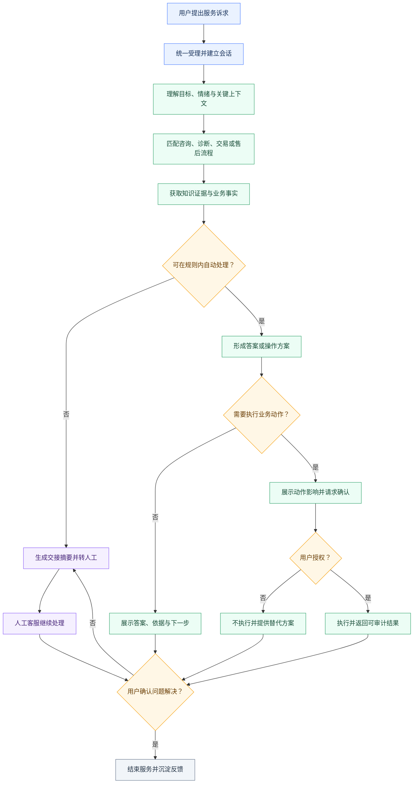
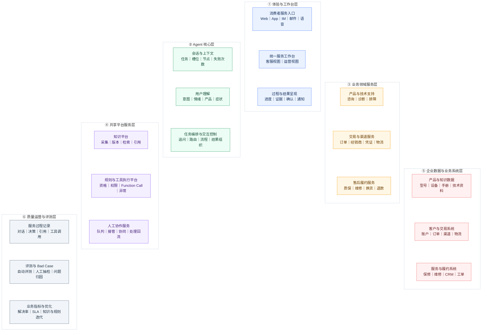
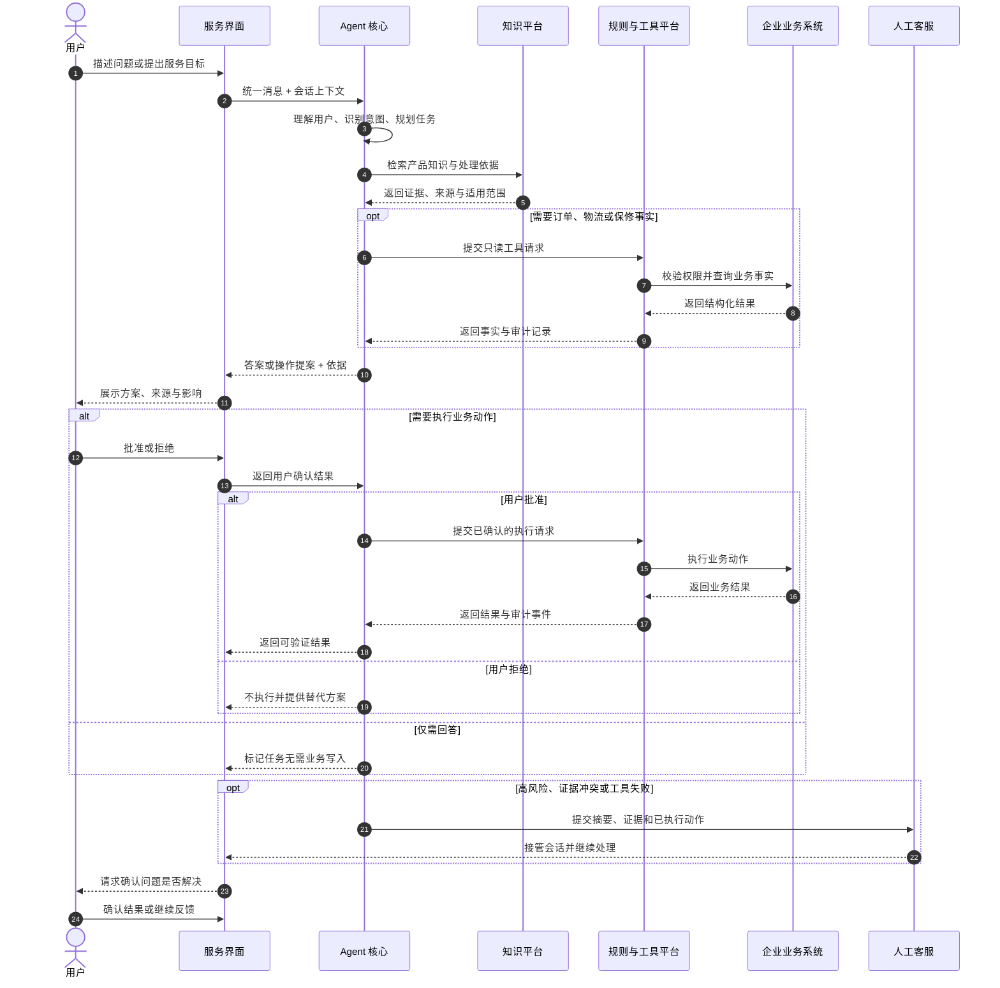
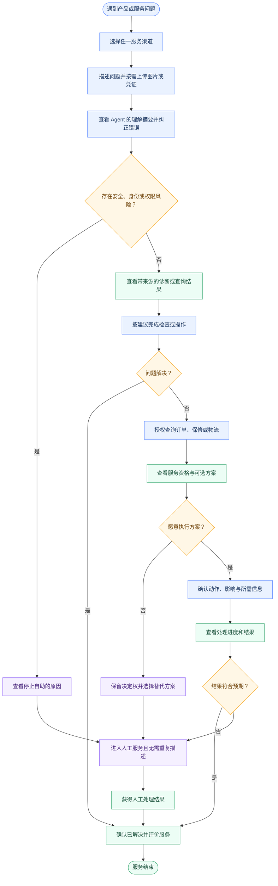

> 历史草稿：当前统一方案见 [智能客服产品方案](../2026-09-19-Anker智能客服产品方案.md)。本文件保留早期范围讨论与实现笔记，不作为当前提交口径。

# Anker 智能服务完整版本（目标态）方案

> 版本：0.1  
> 日期：2026-09-19  
> 状态：目标态产品方案，用于统一长期能力边界与演进方向  
> 上游文档：[Anker 智能服务项目骨架与团队分工](../2026-09-18-Anker智能服务项目骨架与团队分工.md)  
> MVP 方案：[Anker 智能服务 MVP 方案](./2026-09-19-Anker智能服务MVP方案.md)

## 0. 文档目的

本文独立描述企业级智能服务平台的完整目标态，回答四个问题：

1. 产品最终解决怎样的业务问题；
2. 平台由哪些产品能力和业务系统组成；
3. 一次服务中，各组件怎样协作；
4. 消费者、人工客服和服务运营人员分别经历怎样的旅程。

完整版本用于约束长期方向，不等同于当前黑客松开发清单。当前可交付范围以独立的 MVP 方案为准。

北极星结果是：**用户的问题被确认解决，或被无损地交给能够继续处理的人**。Agent 生成回复、调用工具或创建记录都只是中间动作，不等于任务完成。

---

## 1. 完整版本（目标态）

完整版本面向消费者、人工客服和服务运营人员，覆盖咨询、故障诊断、订单与物流、保修与售后、人工接管及持续优化。它不是一个“更会聊天的 FAQ”，而是一套将用户问题从自然语言推进到业务结果的服务平台。

### 1.1 业务流程图（产品解决什么业务问题）

#### 图的叙事主线

目标态解决的是传统客服链路中的四个断点：用户需要反复描述问题；知识回答与订单事实相互割裂；系统能够给建议却不能安全执行；机器失败后人工需要从头接手。

完整业务流程应覆盖以下阶段：

1. **多渠道受理**：接收来自 Web、App、即时通讯、邮件或语音的用户问题，并统一为可处理的会话消息。
2. **理解与澄清**：识别情绪、产品、症状、用户目标和已有信息；只追问会改变下一步行动的关键歧义。
3. **分流与处理**：将任务路由至产品咨询、技术支持、交易与渠道、售后履约等专业服务。
4. **事实获取**：解释性知识从知识平台获取；订单、物流、保修、工单等实时事实从业务系统查询。
5. **方案形成**：组合知识证据、业务事实和规则结果，形成答复、诊断步骤或操作提案。
6. **风险与权限控制**：校验身份、权限、规则和动作风险；高影响动作必须解释影响并获得确认。
7. **执行或接管**：允许的操作通过工具执行；高风险、证据不足、规则冲突或系统失败时生成交接包并转人工。
8. **结果验证**：向用户呈现结果与依据，并确认问题是否真正解决；未解决则继续处理或升级。
9. **运营改进**：沉淀对话、决策、引用、工具调用和结果，用于 Bad Case 复盘、知识更新和规则优化。

#### 流程边界

- Agent 负责理解、规划和提出动作，不直接越权修改业务系统。
- 程序化规则负责身份、权限、资格、幂等和写入校验。
- 用户对高风险或不可逆动作保留最终决定权。
- 人工客服承接例外，而不是成为所有低置信度回答的兜底按钮。
- 流程终点是“已解决”或“已被有效接管”，不是“已经回复”。

#### 主要输入与输出

| 输入 | 核心处理 | 输出 |
| --- | --- | --- |
| 用户文本、图片、语音、设备与账户上下文 | 理解、诊断、查询、规则判断、受控执行 | 有依据的答案、可执行方案、业务处理结果或结构化人工交接 |

### 1.2 产品能力图（产品包含哪些组件）

#### 能力分层

| 层级 | 组成能力 | 核心责任 | 主要输出 |
| --- | --- | --- | --- |
| 体验与工作台层 | 消费者客服入口、人工客服工作台、服务运营后台 | 承载对话、证据、进度、确认、接管和运营配置 | 统一消息、用户确认、人工操作、运营配置 |
| Agent 核心层 | 多模态理解、会话与上下文、意图路由、任务编排、结果与交互控制 | 判断现在该问、该答、该查、该行动、该确认还是该转人工 | 结构化任务、工作流状态、下一步动作 |
| 业务域服务层 | 产品咨询、技术支持、交易与渠道、售后履约 | 在各自业务边界内解释问题、组合事实、形成处理建议 | 带依据的答案、诊断结论、操作提案 |
| 共享平台服务层 | 知识平台、行动网关、规则与执行平台、人工协作服务 | 为各业务域提供可复用的知识、工具、权限、执行和交接能力 | 证据引用、规则结果、工具结果、交接包 |
| 企业数据与业务系统层 | 产品与知识数据、客户与交易系统、订单物流系统、保修售后系统、CRM/工单、会话状态库 | 保存可信事实和业务状态，执行合法状态变更 | 产品事实、订单事实、服务状态、写入结果 |
| 质量运营与评测层 | 全链路日志、决策与工具轨迹、离线评测、Bad Case、产品指标、知识与规则版本 | 证明系统行为可解释、可重放、可评估、可持续优化 | 指标、问题归因、更新任务、版本记录 |

#### 三个容易混淆的边界

**1. 专业处理器与工具执行不是同一件事。**

- 专业处理器理解业务语义。例如技术支持处理器判断“S1 Pro 吸力下降”需要检查哪些症状，并根据证据给出下一步。
- 规则与执行平台判断该动作是否被允许，以及如何安全地调用系统。例如创建售后申请前校验订单归属、资格、确认状态和幂等键。
- 前者产出“应该做什么”，后者负责“能不能做、怎样做、做完是否成功”。专业处理器不得绕过执行平台直接写业务系统。

**2. 人工协作服务与人工客服队列不是同一层。**

- 人工协作服务是平台能力，负责整理交接摘要、路由技能组、保存接管状态以及将处理结果回流会话。
- 人工客服队列是 CRM 或工单系统中的业务对象，保存待处理任务、优先级和分配状态。
- 两者必须相连，但不应画成同一个模块；否则无法区分“协作逻辑”和“业务记录”。

**3. 运营后台与客服工作台服务不同角色。**

- 客服工作台面向一线人员，重点是接管、协同和处理当前服务任务。
- 运营后台面向知识、规则和质量运营人员，重点是配置、审核、复盘和优化。

#### 模块间最小契约

| 契约 | 关键内容 | 生产者 | 消费者 |
| --- | --- | --- | --- |
| 统一消息 | 会话、用户、渠道、内容、附件、时间 | 客服入口 | 会话与上下文 |
| 会话状态 | 当前任务、已知/缺失信息、节点、风险、确认、失败次数 | 会话与上下文 | 编排、人工协作 |
| 意图对象 | 业务域、意图、置信度、参数、缺失参数、风险 | 用户理解/意图路由 | 任务编排、专业处理器 |
| 处理结果 | 完成、需追问、建议动作、失败或需人工 | 专业处理器 | 任务编排 |
| 证据引用 | 来源、版本、适用产品/地区、片段 | 知识平台 | 专业处理器、界面、审计 |
| 操作提案 | 动作、对象、影响、规则依据、确认要求 | 专业处理器 | 规则与执行平台、界面 |
| 工具结果 | 成功/失败、业务结果、错误类型、重试信息 | 行动网关/业务系统 | 编排、结果组织、审计 |
| 服务结果 | 终态、依据、未解问题、下一步 | Agent 或人工客服 | 用户、日志、评测 |

### 1.3 系统时序图（组件之间怎么交互）

#### 参与者及交互原则

| 参与者 | 在一次请求中的责任 |
| --- | --- |
| 用户 | 描述问题、补充必要信息、选择方案、批准或拒绝高影响动作、确认结果 |
| 客服入口 | 统一消息，显示进度、证据、方案、确认和最终结果 |
| Agent 核心 | 维护上下文，识别任务，编排专业处理器，组织结果 |
| 业务域服务 | 解释业务问题，调用知识或提出业务工具请求 |
| 共享平台服务 | 检索证据、校验规则和权限、执行工具、生成交接包 |
| 企业业务系统 | 返回产品、订单、物流、保修、工单等事实或执行结果 |
| 人工客服 | 接管例外任务，读取完整上下文，继续处理并回填结果 |
| 质量运营系统 | 异步记录全过程，用于评估和改进，不阻塞用户主链 |

#### 时序必须表达的四类路径

1. **知识可直接解决**：Agent 调用业务域服务和知识平台，返回带来源答案，用户确认解决。
2. **需要业务动作**：Agent 查询业务事实，生成操作提案，经规则校验和用户确认后调用业务系统。
3. **无法可靠处理**：证据不足、身份失败、规则冲突或多次理解失败时，生成交接包并由人工客服接管。
4. **执行异常恢复**：工具超时或系统不可用时，不宣称成功；保留任务状态，选择重试、替代方案或人工接管。

#### 关键控制点

- 知识引用返回后才能生成确定性产品结论；证据不足必须显式降级。
- 查询类工具可以在身份与权限条件满足后自动执行。
- 写入类工具必须获得有效确认，并在工具内部再次执行规则校验。
- 业务系统返回成功前，界面不得显示“已办理”。
- 交接时传递当前意图、摘要、已收集信息、已执行动作、证据、失败原因和优先级。

### 1.4 User Journey

#### 主要角色与任务

- **消费者**：希望少解释、少等待，得到可信且可执行的解决方案。
- **人工客服**：希望接管时已有完整上下文，不再让用户重复描述。
- **服务运营人员**：希望发现共性问题并更新知识、规则和流程，使问题越来越少地重复发生。

#### 消费者主旅程

| 阶段 | 用户目标与行为 | 产品响应 | 关键数据 | 主要判断与分支 |
| --- | --- | --- | --- | --- |
| 1. 发起求助 | 用自然语言或图片描述问题 | 接收消息，显示已理解的信息和当前进度 | 原始消息、渠道、会话 ID | 是否存在立即停止自助的安全风险 |
| 2. 对齐问题 | 回答少量关键问题 | 识别产品、症状、情绪和目标，只追问会改变行动的信息 | 产品候选、症状、缺失槽位 | 信息是否足够；连续理解失败则转人工 |
| 3. 获得方案 | 按步骤排查或查看答案 | 返回适用条件、步骤和可打开的证据来源 | 知识引用、版本、适用范围 | 是否有可靠证据；无证据则拒绝猜测 |
| 4. 验证效果 | 告知问题是否解决 | 记录结果；已解决则结束，未解决则进入业务处理 | 用户反馈、诊断历史 | 已解决 / 仍未解决 / 出现新风险 |
| 5. 获取服务选项 | 提供必要身份或订单信息 | 查询订单、保修、物流与服务资格，解释依据 | 订单、归属、保修、规则结果 | 身份是否通过、是否有资格、是否需人工审批 |
| 6. 决定是否执行 | 查看动作影响并批准、修改或取消 | 展示操作预览和替代方案，等待明确确认 | 操作提案、确认状态 | 批准 / 拒绝 / 超时；未批准不得写入 |
| 7. 获得结果 | 查看办理结果与下一步 | 返回真实业务状态、编号和预期后续 | 工具结果、案例/工单状态 | 成功 / 失败可重试 / 转人工 |
| 8. 确认解决 | 确认目标是否达成 | 关闭任务，或带完整上下文升级 | 服务终态、未解问题 | 已解决 / 有效接管 |

#### 跨角色交接

当消费者旅程进入人工接管时，人工客服旅程不应重新从“请描述您的问题”开始，而应从“确认 Agent 已整理的信息并处理未解问题”开始。人工处理结果返回同一会话和质量运营层，形成可追溯闭环。

---

## 2. 与 MVP 的关系

完整版本定义长期能力边界，MVP 只选择其中一条能够端到端验证价值的主链。两者共享交互原则和模块契约，但 MVP 不提前建设全渠道、全品类、真实企业系统接入、生产级人工工作台和运营平台。

具体实现范围、数据规则与验收标准见：[Anker 智能服务 MVP 方案](./2026-09-19-Anker智能服务MVP方案.md)。
